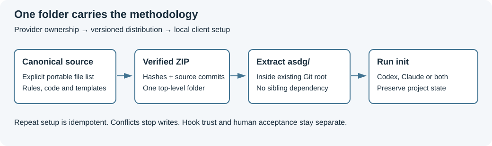

# ASDG — Agentic SDLC Governance

## What is ASDG?

ASDG is a software development method that lets developers work with coding agents under explicit human review and approval.
It gives an existing project shared instructions, specialist roles and versioned project memory across the development lifecycle.
Each project keeps its own versioned `asdg/` folder, so its method can evolve alongside its code.

[Read the ASDG introduction — slides and narration](docs/presentations/asdg-introduction/README.md) · [Browse the presentations](docs/presentations/README.md).
A short playable introduction video is pending publication. These links open presentation sources; generated PowerPoint and preview links inside them require a local build and are absent from GitHub.

## Get started — ZIP + Prompt

Use an existing Git project on macOS or Linux, with Git, Python 3.9+ and Claude Code or Codex available.
You do not need to clone this methodology repository or type Python commands yourself; the assistant runs the installation engine.

1. Download the [portable ZIP — 0.3.0-pilot.1](https://github.com/Elustondo-ai/agentic-sdlc-governance/releases/download/v0.3.0-pilot.1/asdg-0.3.0-pilot.1.zip).
2. Extract its single `asdg/` folder into the root of your existing Git project. **Stop if `asdg/` already exists.**
3. Open your project in Claude Code or Codex and paste the [ZIP installation prompt](asdg/docs/install-zip-prompt.md).
4. Review the preview and approve installation. After verification, the assistant offers the optional Context survey and waits for a separate yes.

**Publication pending:** the ZIP link returned HTTP 404 on 4 November 2026. Before sharing this README, publish the reviewed portable ZIP and its SHA-256 sidecar as assets of release `v0.3.0-pilot.1`; GitHub's automatic source archives are different packages.
This is a pilot candidate awaiting human review; installation checks do not establish native discovery, invocation or hook trust.
See [installation details](asdg/docs/installation.md) and [client integration limits](asdg/docs/client-integrations.md).

## Evolve and contribute — Clone, Promote, Upgrade

For example, LifeBuckets and iShop each keep their own versioned `asdg/` copy.
To share an improvement piloted in LifeBuckets, keep a local canonical checkout:

```sh
git clone https://github.com/Elustondo-ai/agentic-sdlc-governance.git
cd agentic-sdlc-governance
git rev-parse HEAD
```

The last command prints the full commit SHA. Use a reviewed commit containing the installer and a matching package manifest; the current local installation work still needs to be committed and pushed by the maintainer.
The [Clone installation prompt](asdg/docs/install-clone-prompt.md) takes that full SHA, the canonical clone path and the target project path, using the same preview and approval engine as ZIP installation.

`asdg promote` brings the LifeBuckets pilot improvement into the local canonical checkout for review. After reviewing and committing it, a contributor can open a pull request.
After acceptance and packaging of the canonical version, `asdg upgrade` brings that version into iShop. Both commands preview first and require explicit approval to apply; conflicts stop changes.
Use the [project-local commands and synchronization contract](asdg/docs/synchronization.md); no global `asdg` installation is required. Promotion and upgrade do not commit, push or open a pull request for you.



## Methodology and maintainer references

Read the [lifecycle](asdg/docs/lifecycle-baseline.md), [role catalogue](asdg/00-governance/types/agent-catalog.json), [runtime contract](asdg/00-governance/docs/runtime-contract.md) and [CLI reference](asdg/scripts/cli.md).
Maintainers use [build and verification](asdg/docs/distribution-build.md), [source provenance](asdg/docs/provenance.md) and the [provider promotion review](docs/asdg/07-planning/02.1-review-provider-promotion.md).
`docs/` retains methodology development and presentation sources; optional presentation, component and video tools remain outside the portable core's acceptance claim.
