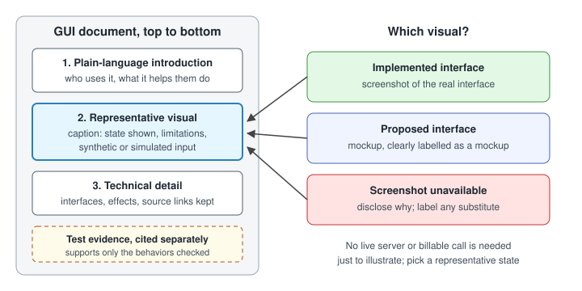

# Representative visuals for graphical interfaces

A reader should see what an interface looks like, and who it is for, before reading how it is built.
This is a mandatory ASDG rule for every adopting project, governance, all twelve specialists and methodology maintenance.
It is part of the [documentation standard](documentation-standard.md); this page is its single authoritative definition.

## When it applies

Any role creating or materially updating documentation, a guide or a design for a graphical user interface.
This includes source companions for page or screen files, user guides, use cases, architecture and low-level designs, proposals and review reports whose subject is a GUI.
A navigation-only index or brief change note may link to the document that carries the visual.

## What the document must do

- Begin with a plain-language introduction explaining who uses the interface and what it helps them do.
- Include at least one representative screenshot or clearly labelled mockup near the beginning, before detailed technical explanation.
- Use a screenshot for an implemented interface and a mockup for a proposed interface.
- If a screenshot cannot be obtained, disclose the limitation and clearly label any substitute; never present a mockup as the implemented interface.
- Caption the visual with the state shown and relevant limitations, including synthetic or simulated input.
- Keep the visual consistent with the interface when it changes materially; a stale screenshot is a documentation gap.
- Preserve useful technical explanations and source links. The visual supplements them and does not replace them.

## Illustration is not verification

A screenshot illustrates one captured state. It does not show that capture, connections, timing or feedback work.
Test results support only the behaviors actually checked; cite them separately and name what they did not cover.
A live server connection or billable API call is not required merely to illustrate the interface.
Choose a representative state that adequately explains it, such as an idle, loaded or fixture-driven state, and say which it is.

## Capturing and storing the visual

Record how the visual was produced: tool, viewport, date, interface state and input source.
Store it with the document's supporting assets, such as a sibling `images/` folder or the client's `docs/`, without widening a sprint's implementation scope.
Write alt text that describes the visible regions, not only the product name.
Inspect the embedded result at a realistic document-pane width, as the [review criteria](documentation-review.md) require.
Record new or replaced visuals with exact-hash receipts under [documentation authority](documentation-authority.md); a receipt is not approval.
