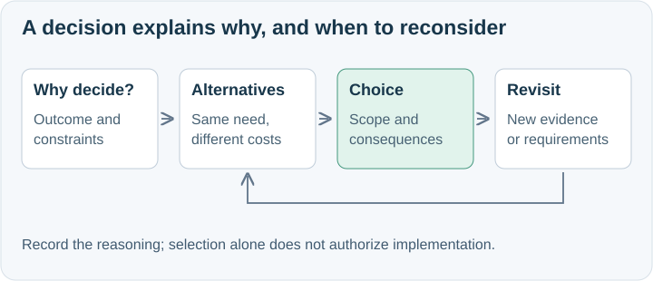

# Explain why the architecture takes this shape

ASDG-05 treats every material high-level architecture decision as an evidence-based choice with consequences.
Its [local decision skill](../skills/decision/SKILL.md) enriches the shared method; these foundations supply the architectural judgment behind that specialization.
A choice is material when it affects system boundaries, quality attributes, dependencies, data/control ownership, deployment, or expensive future change.
Routine implementation details do not become architectural decisions merely to populate documentation.

## Foundational reasoning

Start with the desired user or operational outcome and constraints; explain why a choice is needed before how it works.
Identify the responsibility being assigned and compare viable ways to satisfy it, including the existing approach when relevant.
Separate layers and complementary capabilities; a tool for evaluation is not necessarily a competitor to an execution runtime.
Judge relevant latency, reliability, consistency, security, operability, cost, portability, and maintainability trade-offs in this project's context.
State uncertainty and the limits of evidence. Provider ownership, popularity, a feature list, or a diagram does not establish fitness.
Prefer the smallest sufficient commitment with explicit consequences and a practical path to change it.

## Durable decision knowledge

Document all material decisions produced by assigned architecture documentation work using [ASDG Decision](../../skills/asdg-decision/SKILL.md) and its [package format](../../skills/asdg-decision/record-format.md).
Preserve the current discussion and explicit human selection; distinguish a recommendation from a selected direction.
Cover patterns, placements, interfaces, ownership, resilience, and data choices as well as frameworks and products.
Use short visual explanations: one named decision folder, one or two introductions, and one note per meaningful alternative.
State why the choice is sufficient now, what it costs or constrains, and concrete conditions for revisiting it.
Link a decision to relevant architecture documents within the assigned documentation scope; keep each decision discoverable through its comparison/index.
The [worked example](../../skills/asdg-decision/example.md) illustrates the method without becoming a dependency on its client or vendor.

## Assignment and authority

An analysis-only question can remain conversational. Assigned documentation includes the material decisions it produces; do not repeatedly ask to save them.
The [ASDG-05 contract](../types/contract.md) bounds decision writes and distinguishes them from application implementation and formal acceptance.
A decision record is evidence of reasoning and stated selection, not proof of runtime behavior or authorization to execute the choice.

