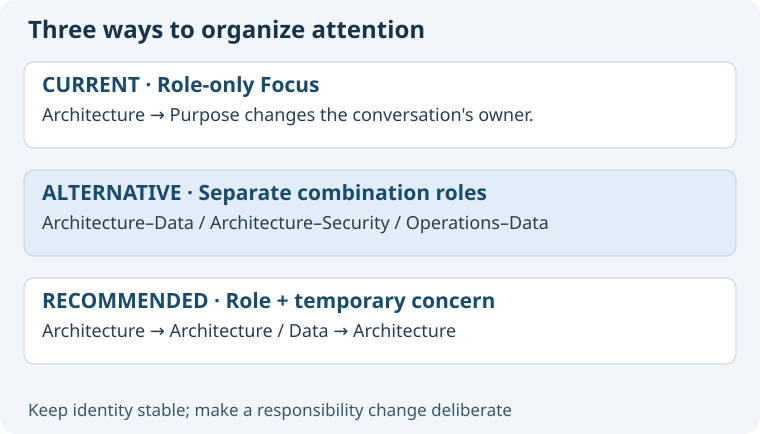

# Why separate responsibility from attention?

The current Focus skill selects a role. Testing it in an established Architecture chat switched that chat to Purpose.
The user then requested protection for specialist continuity and identified Data and Security as concerns shared across roles.

## Actual baseline

The [Focus workflow](../../../skills/asdg-focus/SKILL.md) handles free-text role selection and ambiguity, but has no concern model.
Its [session policy](../../../skills/asdg-focus/session-policy.md) retains one role per conversation and forbids activation by mere mention.
The [Decision extension contract](../../../skills/asdg-decision/specialization.md) already supports optional role-local enrichment.
A separate Purpose chat was found and opened during this conversation. That demonstrates navigation, not an implemented routing policy.
The warning before a cross-role switch was applied conversationally; it is not yet saved in the skill.

## Alternatives

| Option | Benefit | Cost and limitation |
| --- | --- | --- |
| [Keep role-only Focus](10-option-role-only.md) | Minimal change; ordinary prompts can discuss concerns. | Concern context and return behavior remain informal. |
| [Concern-specific role grid](11-option-specialist-grid.md) | Explicit isolated mandates. | Duplicated knowledge, menu clutter and fragmented ownership. |
| [Compose role and concern](12-option-composition.md) | Stable responsibility; shared concern knowledge; sparse specialization. | Requires explicit context resolution and conflict handling. |

Recommend composition, retaining ordinary conversation for lightweight questions.
This is a design judgment grounded in the user's workflow, not a measured productivity result.
Separate chats and subagents are execution arrangements available to the design; they are not competing definitions of Concern.

## Consequences and revisit conditions

The shared library needs an owner and review discipline; loading every concern for every task would waste attention and tokens.
Focus must report which role remains responsible and must not hide relevant consequences outside the selected concern.
Start with three concerns and two roles; extend only where real tasks reveal recurring guidance.
Reconsider the design if the pilot produces silent role switches, duplicated guidance, confusing return behavior or more ceremony than useful evidence.
If concern knowledge never needs to be retained between turns, role-only Focus may be sufficient.
If legal or organizational accountability demands an independently owned specialist function, propose a real role explicitly instead of treating it as a concern mode.
