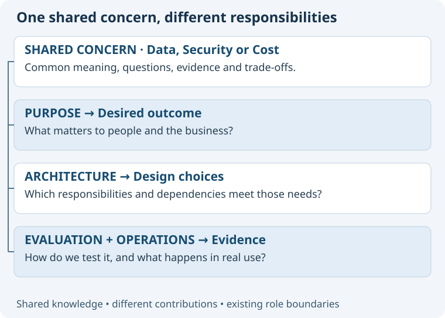

# Twelve concerns in plain language

A concern is something that matters to the outcome. It can be a subject, a desired quality or a business obligation.
The twelve entries are a starting vocabulary, not twelve gates or mandatory checklists.

| Concern | Main question | Stable proposed ID |
| --- | --- | --- |
| Value & Cost | Is it worthwhile, and what does it cost to build, run and change? | value-cost |
| People & Experience | Can people understand, access and use it effectively? | people-experience |
| Data | Is the information accurate, useful and well managed? | data |
| Security | Are we protected against unauthorized access and misuse? | security |
| Privacy | Are we respecting people's information, choices and expectations? | privacy |
| Reliability & Recovery | Can people depend on it when things go wrong? | reliability-recovery |
| Speed & Capacity | Is it fast enough, and can it handle demand? | speed-capacity |
| Integration | Does it work with the other systems we need? | integration |
| Operations & Visibility | Can we run it, see what is happening and resolve problems? | operations-visibility |
| Change & Adaptability | Can it evolve as needs and dependencies change? | change-adaptability |
| Compliance & Accountability | Can we meet obligations and show who is responsible? | compliance-accountability |
| Safety & Human Control | Can we avoid harm and preserve appropriate human control? | safety-human-control |

## Boundaries without artificial silos

Security addresses unauthorized actions; Privacy addresses appropriate use even by authorized actors.
Data covers meaning, quality, ownership and lifecycle; its confidentiality or recovery needs connect to other concerns.
Reliability concerns dependable outcomes; Operations concerns the ability to run and investigate the system.
Cost includes money, time, effort and future change. “Focus on Cost” resolves directly to the cost aspect of Value & Cost.
AI accuracy, uncertainty and autonomy belong to relevant concerns rather than requiring a thirteenth AI category.
Compute, databases and messaging are useful topics within a task; they need not become top-level concerns.

## Library rules

Each concern defines its purpose, aliases, common questions, relevant evidence, overlaps and typical trade-offs.
Use stable words for IDs; display order is not a lifecycle number. “05” continues to mean Architecture, never Privacy.
Local terminology may refine an existing concern. Create a new concern only when recurring needs cannot be expressed clearly with the existing vocabulary.
Governance maintains shared definitions through authorized methodology changes, informed by specialist experience.
A concern never owns the entire project or authorizes actions; the active role remains responsible.
