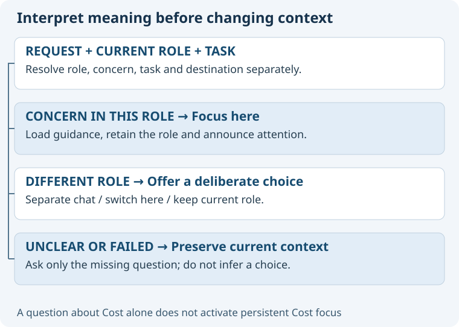

# Focus should preserve the conversation's owner

Interpret the user's whole request against the current role, task and concern. A word match alone is insufficient.
The following behavior is proposed; the current skill still implements role selection only.

| Situation | Proposed behavior |
| --- | --- |
| New chat: “focus on architecture” | Load 05, activate it, then report the role. |
| New chat: “focus on Data” | Record a pending concern and ask which responsibility is needed; do not infer Architecture. |
| Architecture: “focus on Data” | Keep 05, load Data guidance, announce the temporary focus. |
| Architecture: “how much will this cost?” | Answer using Cost; do not silently change persistent focus from an ordinary question. |
| Architecture: “focus on business intent” | Resolve Purpose; offer separate Purpose chat, switch here, or keep Architecture. |
| Architecture: “switch this chat to Purpose; keep its history” | Explicit informed reassignment is sufficient; do not ask again. |
| “Back to overall architecture” | Clear concern focus; retain 05 and the task. |
| “Clear role / return to general assistant” | Clear role and concern after an explicit request. |
| “Back” with several plausible meanings | Ask whether to restore previous concern or return to the role's overall view. |
| Quoted examples or explaining Focus | Discuss only; do not activate or change anything. |

## Choosing without clutter

A bare Focus invocation in an unfocused chat offers twelve selectable roles with Governance separately.
In a focused chat, offer overall view, choose a concern, or change role; accept free text throughout.
If a role is already known and no concern can be resolved, offer the twelve selectable concerns.
For real ambiguity, show only plausible interpretations, a recommendation with a reason, and alternatives.
If the client cannot display twelve options accessibly, present a compact fallback list; never silently truncate choices.
A preselected choice, timeout or praise is not an answer.

## Protecting existing chats

Before a cross-role change, recommend reusing an existing specialist chat; create one only when explicitly selected and no suitable chat is confirmed.
The current role, focus and title remain intact until the user chooses a destination or reassignment.
Opening a chat is navigation; sending it a task or context is a separate action requiring authorization.
“Go back to 05” immediately after an accidental switch is an explicit restoration request, not another onboarding interview.
Keep the public entry as ASDG focus. Document the distinction so existing numeric role shortcuts remain usable.
