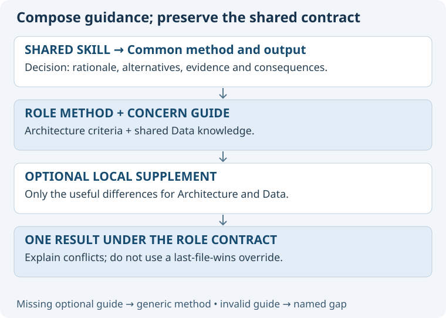

# One method, enriched by role and concern

A Skill is a reusable method. Its interface accepts the task and context; optional guidance deepens its application.
This extends the existing Decision enrichment pattern without creating a skill for every role-concern pair.

## Proposed loading contract

1. Resolve the role through the existing role catalogue and concerns through a new shared concern index.
2. Read the role contract and the shared skill's required sources before performing work.
3. Load the role-local method when present, using the existing Decision path.
4. Load the selected concern's shared guidance once.
5. Load a role-local concern supplement when present; absence means use shared guidance.
6. Apply the method and return its normal result with relevant concern evidence and trade-offs.

| Proposed source | Responsibility |
| --- | --- |
| Existing `asdg/skills/<skill>/SKILL.md` | Shared workflow and output contract. |
| Existing `<role>/skills/decision/SKILL.md` | Optional architectural, evaluation or other role criteria. |
| New `asdg/concerns/catalog.json` | Stable IDs, aliases and canonical paths. |
| New `asdg/concerns/<id>/README.md` | Shared concern knowledge, questions and evidence. |
| Optional `<role>/concerns/<id>.md` | Only meaningful differences for this role. |

These are proposed source paths, not created runtime packages.
Concern guides are knowledge resources, not public skills or agents. Local supplements need no discovery adapter.
Do not create 144 empty role-concern files or a third skill-by-role-by-concern directory hierarchy.
A supplement can contain a short Decision-specific section if experience justifies it.

## Composition and conflict rules

The role contract, shared method obligations and runtime permissions remain binding.
Concern guidance can add questions, criteria and explanatory views; it cannot remove evidence requirements or widen authority.
A local supplement may refine generic advice, identifying the reason and context. Contradictory requirements must be surfaced, not resolved by “last file wins.”
Absent optional guidance uses the generic method. Present but unreadable or invalid guidance produces a named gap, not silent fallback.
Unrelated work may continue; do not claim the missing specialization was applied.
Resolve paths from catalogues and trusted repository definitions, never by concatenating arbitrary user text.
Do not recursively invoke shared and local skills; track sources already loaded.

## Applying existing skills

Decision returns the same rationale, alternatives, evidence, choice status, consequences and revisit conditions, now noting relevant concerns.
Role explains stable responsibility and current attention separately. Status reports both; Suggestion uses both without changing them.
Concern focus does not require a saved decision for every answer. Save material assigned decisions under the existing owning contract.
