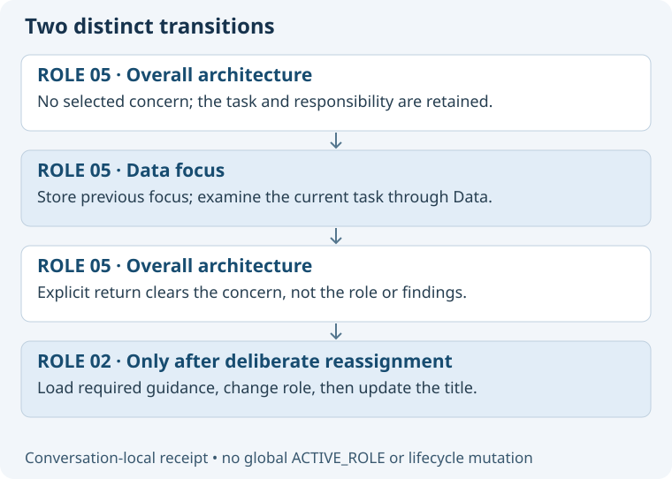

# Retain role and focus separately

The session needs a small conversation-local context, not a shared global “active specialist” file.
A concern change is reversible attention; a role change is a responsibility transition.

## Proposed context fields

| Field | Meaning |
| --- | --- |
| project | Verified project binding; unknown stays unknown. |
| role | One selected catalogue role, None, or Unknown if recovery evidence is lost. |
| concern_focus | Zero or more selected concern IDs, with one primary concern when useful. |
| task_scope | The current question, deliverable, subject and limits. |
| previous_focus | One prior concern set and scope for explicit return; no unbounded focus stack. |
| activation_receipt | User request, resolved role/concerns, source paths and versions actually read. |
| pending_choice | Unresolved candidate or destination; does not replace active context. |
| integration_owner | Who combines findings when work is split; absent for ordinary solo work. |

Allow multiple concerns when requested, such as “Cost and Reliability”; recommend one or two for clarity rather than enforce an arbitrary hard limit.
A narrow focus increases depth, not permission to ignore consequential effects elsewhere.
“Overall architecture” clears concern_focus. “Previous focus” restores the saved concern set after checking its guidance.
A new role assignment clears old role-specific focus by default; retain a concern only when the user's request makes that intent clear.

## Lifecycle and failure handling

Read and validate required guidance before committing a transition. Failed loading leaves prior role, concern and title intact.
A rename failure leaves a successfully activated context intact and is reported separately.
Keep the base title role-based; optionally add the concern suffix after activation, such as “05 Architecture · Data — Speaker Coach.”
The title is presentation, never proof of activation or authority.
Retain the receipt during compaction. If role history is lost, report Unknown and ask for reaffirmation; never infer it from filenames or a title.
If only concern history is lost, retain the verified role and ask which focus to resume.
On changed guidance, reload relevant sources and disclose material changes before relying on previous conclusions.

## Authority and persistence

Focus creates no implementation, approval, deployment, messaging or delegation authority.
Keep active context in this chat. Durable deliverables reference concerns but do not become a second lifecycle or sprint state store.
A future optional team directory could map roles to chats; it must verify current native state and handle stale or duplicate entries.
Do not introduce that directory during the first pilot; use native discovery with explicit limitations.
