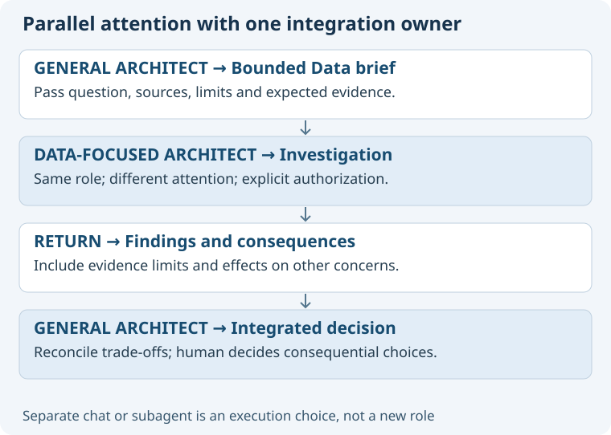

# One role can have several focused investigators

Start with one agent when sequential attention is sufficient. Split work only when the expected insight justifies coordination cost.
The general architect remains responsible for integrating architectural findings.

| Arrangement | Use when | Continuity and control |
| --- | --- | --- |
| Same chat, temporary concern | The user wants deeper examination now. | Same role, history and owner; return to overall view afterward. |
| Separate user-owned chat | The user wants an enduring parallel workspace. | Explicit creation or reuse; pass only authorized context and assignments. |
| Bounded subagent | An explicitly authorized delegated investigation can proceed independently. | Parent retains integration; child returns findings through its supported channel. |

An explicitly requested second architect can have role 05 and focus Data without replacing the first architect.
A concern does not create a new ASDG role ID or imply a new person with approval authority.
Existing project permissions and delegation restrictions apply to every participant.

## Minimum investigation brief

State the project, role, concern, question, source baseline, output expected, allowed actions, exclusions, and integration owner.
Pass relevant decisions and uncertainties with provenance; distinguish accepted choices from proposed documents.
Use the smallest sufficient source set. A fresh chat does not inherit this conversation automatically.
For read-only work, say so explicitly. If writes are separately authorized, allocate nonoverlapping files and preserve other contributors' edits.
Agree a stopping condition: return the bounded answer and evidence, not an expanding autonomous research programme.

## Return and synthesis

Return findings, alternatives, evidence, confidence limits, affected concerns and unresolved trade-offs.
The parent checks source freshness and conflicting assumptions before incorporating findings into the authoritative decision.
A Data investigator may recommend retention that conflicts with Privacy or Cost. The integrating architect explains the conflict and the human decides consequential trade-offs.
An investigator's recommendation is not a parent decision, user approval or proof of independent review.
If the investigator fails, report the unanswered question; partial work does not become complete evidence.

## Routing safeguards

Match project and verified role before reusing a chat; inspect candidates rather than trusting titles alone.
Limited inventory is not proof that no chat exists. Ask or provide a manual route if a suitable existing chat cannot be resolved.
Avoid duplicate creation after uncertain tool results. Report created, activated, assigned and completed as separate outcomes.
Opening an existing chat needs no work message. Sending a brief requires explicit authorization; authorization is not implied by a concern selection.
