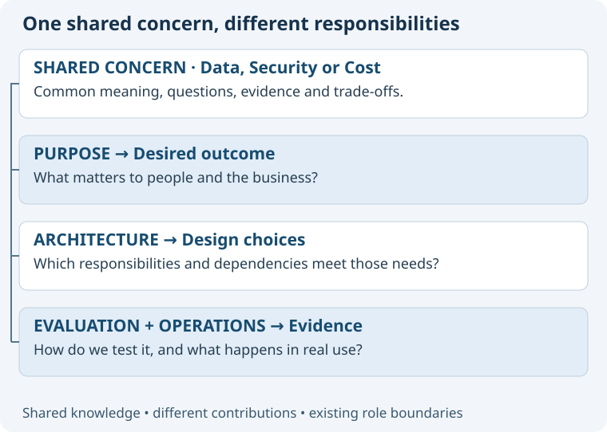

# The same concern changes meaning across roles

Cost illustrates why concerns should cross the lifecycle. Each role produces evidence appropriate to its responsibility.
The specialist contract still determines whether that contribution is an assessment, proposal or authorized delivery.

| Role | Cost question | Typical contribution |
| --- | --- | --- |
| 01 Context | Who pays, who spends time, and what constraints exist? | Stakeholder and cost-context evidence. |
| 02 Purpose | Which benefits justify the expense? | Desired value, affordability and non-goals. |
| 03 Use Cases | Which interactions create workload or user effort? | Scenarios and demand assumptions. |
| 04 Evaluation | How should alternatives be compared fairly? | Measurement protocol and comparable cost basis. |
| 05 Architecture | Which boundaries and dependencies drive lifetime cost? | Trade-offs, assumptions and revisit triggers. |
| 06 POC | Which uncertain cost driver needs an experiment? | Bounded feasibility evidence. |
| 07 Planning | What effort, dependencies and budget affect sequencing? | Scoped work and explicit estimates. |
| 08 Detailed Design | Which interface behaviors create unnecessary work? | Contracts for batching, retries and resource limits. |
| 09 Build & Test | Does implementation behave within the agreed limits? | Observations from authorized implementation and tests. |
| 10 Review & Release | Is cost evidence sufficient for this candidate? | Readiness findings and unresolved risks. |
| 11 Operations | What does it actually cost to run and recover? | Usage, support and operational evidence. |
| 12 Insights | What patterns suggest improvement? | Learning and candidate improvements. |

Governance coordinates ownership and cross-role conflicts; it does not become the owner of every cost calculation.

## Other concerns follow the same pattern

For Security, Purpose identifies protection expectations; Architecture defines trust boundaries; Evaluation defines attack and misuse tests; Operations examines access and incidents.
For Data, Purpose identifies useful information; Use Cases models its meaning; Architecture allocates ownership; Operations examines retention and recovery.
The same source may inform several roles, but each should add its own evidence or reasoning rather than copy the same checklist.
Concerns do not reorder lifecycle stages or require all stages to run for each question.

## Keeping the library small

Start with shared Data, Security and Value & Cost guidance, plus demonstrated role-local needs.
Compare Architecture and Purpose in the first pilot; add Evaluation and Operations after the interface proves useful.
Do not claim to cover all twelve concerns just because their names appear in a catalogue.
Measure usefulness through clearer questions, preserved ownership and reviewable evidence, not document or agent counts.
