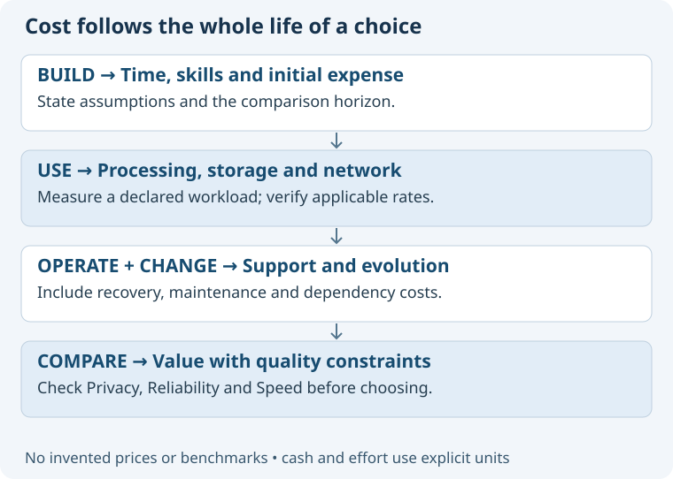

# Worked example: focus on Cost

Scenario: the Speaker Coach architect is assessing a local service connected to a cloud model for live interview assistance.
This example illustrates the proposed method; it does not reopen the selected SDK decision or claim measured costs.

## A useful conversation

User: “Focus on Cost for the live meeting architecture.”
Assistant: “Still 05 Architecture. I will examine build, runtime, operational and change costs for this meeting flow.”
The task remains architecture evaluation. Purpose owns the value judgment; Evaluation can define measurements; Operations supplies actual running costs.

## Frame the decision before calculating

Use a declared workload: meeting length, sessions per month, concurrent users, audio handling, model input/output, retention and expected retries.
Distinguish one-time effort from recurring costs, user effort from provider charges, and cash expenses from uncertain opportunity costs.
A planning expression is:
**Total cost = build effort + usage charges + storage/network + operation/support + expected change and recovery effort.**
Keep each term's unit and horizon explicit; use ranges or “unknown” instead of adding incompatible quantities or inventing precision.
Do not treat a user's existing laptop or an engineer's time as free; explain whether the comparison uses incremental cash or full economic cost.
Provider rates would need dated primary-source verification during a real assessment; this proposal makes no pricing claim.

## Compare credible scenarios

| Scenario | Main trade-off | Evidence needed |
| --- | --- | --- |
| Every transcript update triggers reasoning | Frequent opportunities for advice; potentially more work. | Calls per minute, useful updates, latency and usage. |
| Reason only on meaningful conversation events | Potentially less work; may delay or miss useful guidance. | Event recall, advice timeliness and measured usage. |
| Local preprocessing before cloud reasoning | Potentially less transmitted content; local complexity and maintenance. | Reduction achieved, quality impact, resource use and support effort. |

These are illustrative candidates, not authorized changes or benchmark winners.
Check Privacy, Reliability and Speed before recommending a cheaper design: cost reduction is not success if it undermines the purpose.
Define an observation that could reverse the recommendation, such as missed advice, unacceptable latency or materially higher operating effort.

## Result and return

A Decision result states assumptions, comparable options, known evidence, unknown costs and a proposed choice with revisit triggers.
“Return to overall architecture” removes the Cost focus; its findings remain linked to the architectural decision.
Only assigned documentation creates a package. A conversational estimate stays conversational unless the user asks to save it.
