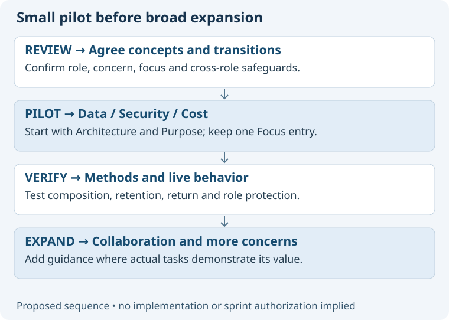

# Adopt the model through a bounded pilot

Recommended implementation order below is a proposal, not an active sprint or permission to modify operational policies.
Each increment should leave the existing role catalogue and approved client artifacts usable.

| Increment | Proposed changes | Completion evidence |
| --- | --- | --- |
| 1. Agree the contract | Review vocabulary, role-switch safeguard, clearing semantics and ownership. | Explicit decision on these behaviors. |
| 2. Pilot concern focus | Add shared index and Data/Security/Cost guides; update Focus, session policy and tests. | Correct same-chat transitions and no silent role changes. |
| 3. Compose skills | Enrich Decision, Role, Status and Suggestion; add only needed role supplements. | Shared method outputs remain valid across Architecture and Purpose. |
| 4. Integrate team routing | Align Create team, native role adapters, templates and installation checks. | Reuse, creation and navigation outcomes verified in the app. |
| 5. Trial parallel attention | One authorized Data investigation with a general architect integrating. | Bounded brief, preserved ownership and evidence-based synthesis. |
| 6. Expand deliberately | Add concern guides and roles where recurring use justifies them. | Demonstrated value and manageable guidance size. |

## Behavior acceptance cases

| Given / request | Expected result |
| --- | --- |
| Unfocused / “Data” | Ask role; no fabricated architect selection. |
| Architecture / “focus on cost” | Role remains 05; Value & Cost focus activated after reads. |
| Purpose / “focus on security” | Purpose questions about protection outcomes, not design implementation. |
| Architecture / “how much does it cost?” | Relevant answer; no persistent focus transition. |
| Architecture / “business intent” as Focus request | Offer separate Purpose chat or deliberate reassignment. |
| Architecture / explicit informed switch | Switch once; no redundant confirmation. |
| Data focus / “overall architecture” | Clear concern; retain role and task. |
| Any role / quoted focus example | No context mutation. |
| Pending selection / timeout | Existing context and title remain. |
| Missing optional supplement | Generic role-plus-concern method works. |
| Invalid existing supplement | Named gap; no silent claim of successful specialization. |
| Concern suggests wider permissions | Preserve role and runtime boundaries. |
| Resume with lost receipt | Report unknown context; ask only for missing selection. |
| Existing chat not in limited inventory | Do not claim absence or create an automatic duplicate. |
| Authorized second architect / Data | Parent stays general; child has bounded scope; findings return for integration. |
| Concern-specific choice / conflicting evidence | Surface affected concerns and unresolved human decision. |

## Migration and evaluation

Keep numeric role shortcuts and the single public Focus adapter. Register no public concern-specific skills.
Existing chat receipts retain their role and start with no concern; do not mass-rename or message the team.
Preserve existing decision paths and hashes; add concern context only when an artifact is actually revised.
Run source/link/structure tests, isolated semantic exercises, then live picker, retention, switching and recovery checks.
Source tests alone cannot establish native behavior. Record task success, clarification burden, unwanted switches and guidance size without inventing numeric thresholds.
Roll back pilot behavior by reverting its bounded source changes, retaining review history and client evidence; explain how active concern contexts return to overall role view.
