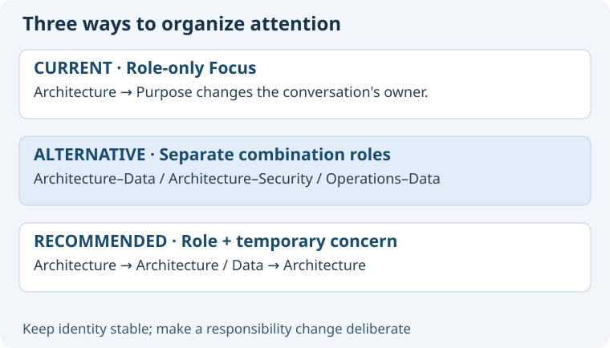

# Alternative: keep role-only Focus

Continue using Focus exclusively to choose a lifecycle role; discuss Data, Security and Cost through ordinary prompts.

## Fit and benefits

This is closest to the current implementation and has the lowest migration cost.
It is sufficient if concern questions are brief and do not require retained guidance or reliable return behavior.
Add a warning before role changes and the immediate team-continuity problem is reduced.

## Limitations

There is no explicit concern context for Decision, Status or Suggestion to consume.
Different roles may repeatedly invent the same concern guidance.
“Return to general” and “go back” remain easy to confuse with clearing the role.
Parallel specialists can still work, but their concerns are expressed only in individual assignments.

## Recommendation

Keep ordinary concern questions lightweight, but do not use this as the sole long-term model.
Reconsider it if the composition pilot adds more clarification and source loading than useful continuity.
Its behavior remains a valuable fallback when concern guidance is unavailable and the user chooses a general analysis.
