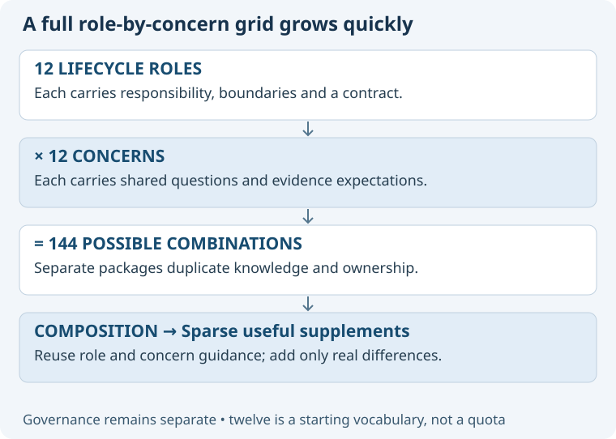

# Alternative: define a role for every concern combination

Create explicit specialist identities such as Architecture–Data, Architecture–Security and Operations–Data.

## Fit and benefits

Dedicated identities make sense when there is a genuinely separate mandate, accountable owner or independently governed delivery function.
They may provide stronger isolation for specialized work, although instructions alone do not prove runtime enforcement.

## Costs and failure modes

Twelve roles multiplied by twelve concerns would suggest 144 combinations before methods, project context or governance.
That is an illustrative upper bound on a full grid, not a proposal to create those agents.
Most packages would duplicate role duties, concern knowledge or both; changes could drift across copies.
Users would face a larger picker and uncertain ownership when several combinations describe the same task.
A focus change could repeatedly change identity or create another chat.

## Recommendation

Do not make concern combinations new canonical ASDG roles by default.
Allow multiple instances of an existing role with explicit concerns when the user wants parallel work.
Propose a genuinely new role through governance only when its separate responsibility cannot be represented by a task and concern.
