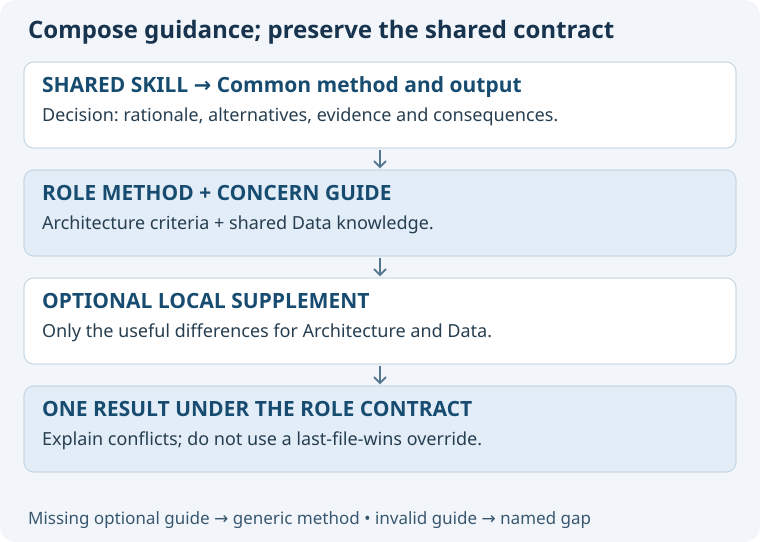

# Recommended: compose role, concern and method

Keep the existing role catalogue. Add shared concern knowledge and a conversation-local focus that reusable skills can consume.

## Why this fits

It preserves the specialist's responsibility while supporting temporary depth.
The same Data guide can help Purpose, Architecture, Evaluation and Operations, with sparse local enrichments.
The existing Decision dispatch pattern offers a concrete starting point: shared interface, optional context-specific guidance.
One public Focus entry supports both familiar role selection and temporary concern attention.

## Costs and controls

Resolution becomes more sophisticated: a phrase may describe a role, concern, task or destination.
Expose the interpretation and ask only when it materially changes responsibility or leaves genuine ambiguity.
Loading too much guidance can reduce usefulness; load selected concerns and necessary overlaps, not the whole library.
Knowledge can conflict; retain authority boundaries, surface incompatible requirements and explain local refinements.
Parallel work adds coordination cost; start with a single agent and explicitly authorized bounded experiments.

## Proposed selection and revisit

Recommend this option for a Data/Security/Cost pilot with Architecture and Purpose.
The user has endorsed the vocabulary, not yet this complete implementation contract.
Revisit after observable pilot evidence: reliable role retention, useful specialization, manageable clarification and preserved authority.
Do not claim success from directory structure, passing syntax checks or this proposal's completion.
