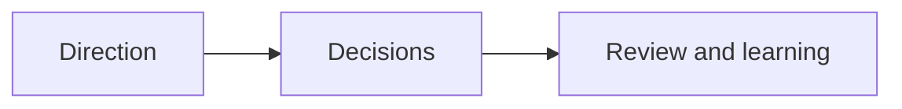

# How we manage this project

Keep the whole project understandable: its direction, decisions, selected work and evidence.

## What belongs here

Record who makes decisions, how work is selected and which questions remain open.

## Project details

Project-specific details are not supplied by initialization. Existing evidence may be documented elsewhere; this introduction makes no claim about its presence or approval.

Optional setup answers belong in a separate project-orientation note. They help begin the conversation without replacing Purpose or Context review.
