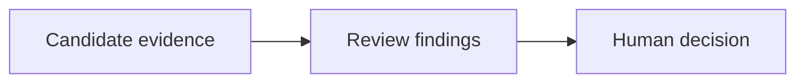

# Review and release

Assess a candidate delivery using requirements, implementation, documentation and test evidence.

## What belongs here

Record readiness findings and unresolved issues. Review recommendations do not themselves approve a release.

## Project details

Project-specific details are not supplied by initialization. Existing evidence may be documented elsewhere; this introduction makes no claim about its presence or approval.

Read root files in order: `01` Intended, `02` Current, `03` Planned. Additional topics use `01.1`, `02.1`, `03.1`, and so on; plan filenames identify release or sprint scope.

Create only useful documents. After a cycle finishes, consolidate verified results into `02` Current files before removing only that cycle's temporary plans; preserve decisions and review history.
