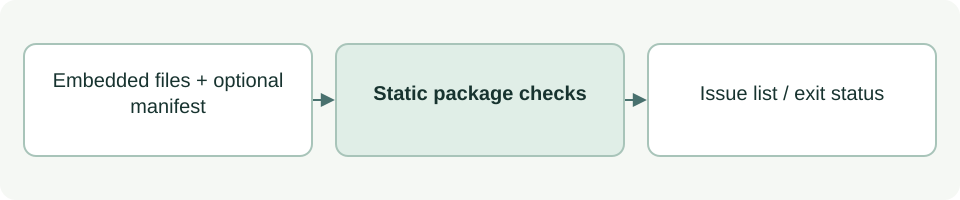

# Validate the embedded package

[Source: check.py](check.py)

Checks reusable ASDG files for structural problems before they are used or packaged.

## Responsibilities and collaborators

Validates the selected portable catalogue/rules, role adapters, Python 3.9 syntax, Markdown size/links and optional candidate hashes.

- [agent_config](lib/agent_config.md): Reads adapter TOML.
- [cli_model](lib/cli_model.md): Validates the catalogue.
- [cli_status](lib/cli_status.md): Checks lifecycle rules.
- [documentation](lib/documentation.md): Counts Markdown source lines.
- [distribution_files](lib/distribution_files.md): Resolves the explicit, safe portable file list.

## Interface and data

validate takes core:Path and integrity:bool and returns list[str] of issues. CORE is the embedded asdg directory. main returns a process exit code.

| Callable or interface | Contract |
| --- | --- |
| `validate(core=CORE, integrity=False)` | Checks selected package files and link closure; optional integrity compares their hashes and version with MANIFEST.json. |
| `main()` | Parses --integrity, prints failures with exit 1 or a validation summary with exit 0. |

## Effects and failure behavior

This is a static check, not proof of live agent behavior or semantic completeness. A link must resolve inside the selected package even when an excluded provider file exists locally. Historical delivery manifests are retained separately; integrity checks the current candidate.

## Example

`python3 asdg/scripts/check.py` checks structure and links; add `--integrity` before building or checking an extracted distribution.
