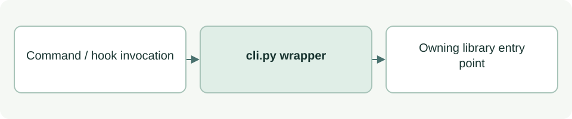

# Run the local ASDG CLI

[Source: cli.py](cli.py)

Exposes the shared command dispatcher without relying on a machine-wide ASDG installation.

## Responsibilities and collaborators

Sets the local library import path and disables Python bytecode writes before invoking the owning module.

- [cli](lib/cli.md): Owns parsing/execution and the returned process status.

## Interface and data

Executable script with no locally defined classes or functions. Arguments and stdin/stdout are its external interface.

| Callable or interface | Contract |
| --- | --- |
| `__main__ dispatch` | Forwards process arguments unchanged. Commands differ in side effects; factual JSON status is read-only. |

## Effects and failure behavior

Propagates the selected handler's process status via sys.exit. Importing the script still changes sys.path and bytecode settings, but the main dispatch is protected by __name__.

## Example

python3 asdg/scripts/cli.py status --json
