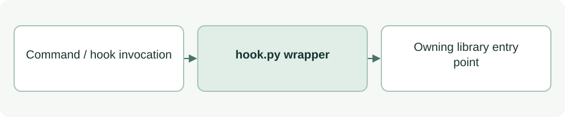

# Dispatch installed project hooks

[Source: hook.py](hook.py)

Derives the project root from its own installed location, then routes guard and logging invocations.

## Responsibilities and collaborators

Sets the local library import path and disables Python bytecode writes before invoking the owning module.

- [cli_hook](lib/cli_hook.md): Owns parsing/execution and the returned process status.
- [agent_log_hook](lib/agent_log_hook.md): Owns the log operation.

## Interface and data

Executable script with no locally defined classes or functions. Arguments and stdin/stdout are its external interface.

| Callable or interface | Contract |
| --- | --- |
| `__main__ dispatch` | With no arguments calls the guard; exactly log selects agent_log_hook. Other arguments exit with an unsupported-operation error. Reads JSON stdin through the chosen handler. |

## Effects and failure behavior

Propagates the selected handler's process status via sys.exit. Importing the script still changes sys.path and bytecode settings, but the main dispatch is protected by __name__.

## Example

python3 asdg/scripts/hook.py log
