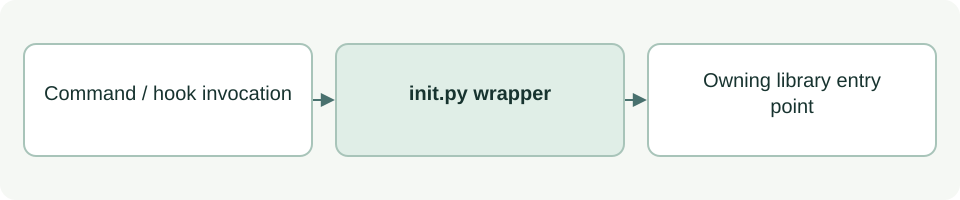

# Initialize a local ASDG project

[Source: init.py](init.py)

Convenience entry point that prepends the init subcommand before forwarding arguments to the shared dispatcher.

## Responsibilities and collaborators

Sets the local library import path and disables Python bytecode writes before invoking the owning module.

- [cli](lib/cli.md): Owns parsing/execution and the returned process status.

## Interface and data

Executable script with no locally defined classes or functions. Arguments and stdin/stdout are its external interface.

| Callable or interface | Contract |
| --- | --- |
| `__main__ dispatch` | May write integration files and state when not dry-running; authorization and conflict checks are owned by the dispatcher and initializer. |

## Effects and failure behavior

Propagates the selected handler's process status via sys.exit. Importing the script still changes sys.path and bytecode settings, but the main dispatch is protected by __name__.

## Example

python3 asdg/scripts/init.py --client claude --dry-run previews a Claude setup; `--client codex` or `--client both` selects other integrations.
