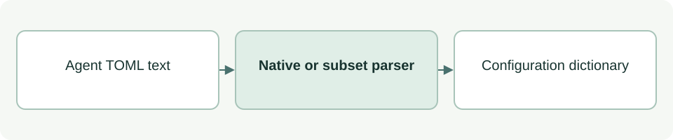

# Read agent adapter configuration

[Source: agent_config.py](agent_config.py)

Allows the package validator to read agent TOML adapters on Python versions with and without tomllib.

## Responsibilities and collaborators

Uses the native TOML reader when available and a strict flat-string subset parser otherwise.

- [check](../check.md): Validates adapter identities and instruction fields.
- [test_agent_config](../../tests/test_agent_config.md): Checks fallback compatibility, escaping and rejection behavior.

## Interface and data

Input is TOML text:str; output is a dictionary. The fallback accepts quoted string fields, comments and supported multiline/basic escapes; it does not implement full TOML.

| Callable or interface | Contract |
| --- | --- |
| `flat_strings(text)` | Parses the supported flat string subset and rejects duplicate keys or unsupported syntax. |
| `loads(text)` | Dispatches to tomllib.loads when available, otherwise flat_strings. |

## Effects and failure behavior

Invalid input raises ValueError or parser-specific decoding errors. Native tomllib can accept constructs outside the fallback subset; portable adapters must stay within the tested common subset.

## Example

`flat_strings('name = "asdg_02"')` returns `{'name': 'asdg_02'}`.
