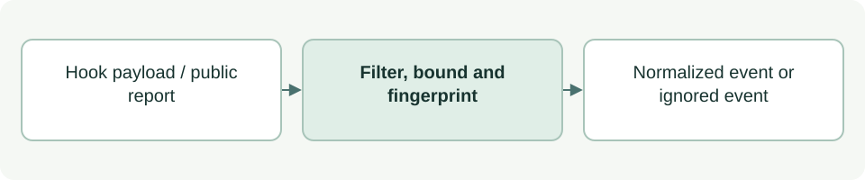

# Normalize public agent activity

[Source: agent_log_event.py](agent_log_event.py)

Converts supported Codex lifecycle events into small records without retaining raw tool arguments, outputs or full transcripts.

## Responsibilities and collaborators

Owns event/identity filtering, bounded public summaries, simple redaction and deduplication fingerprints.

- [agent_log_hook](agent_log_hook.md): Supplies incoming hook payloads.
- [agent_log_store](agent_log_store.md): Persists normalized records.

## Interface and data

normalize accepts a payload dict and returns a normalized dict or None. Supported events are SubagentStart/Stop and Pre/PostToolUse/PostToolUseFailure. Outcomes are OK, OUT_OF_SCOPE, BLOCKED and ERROR.

| Callable or interface | Contract |
| --- | --- |
| `identifier(value, field)` | Returns a validated short identifier string or raises ValueError. |
| `clean_text(value, limit=400)` | Returns whitespace-normalized text up to limit (default 400), with recognized token patterns redacted. |
| `relative_paths(value)` | Returns at most twelve safe relative paths; ignores invalid or sensitive-looking entries. |
| `public_report(message)` | Extracts the last explicitly labelled asdg-log JSON block and returns present/missing/invalid report data. |
| `normalize(payload)` | Filters supported named-role events, copies allowed metadata and attaches a SHA-256 fingerprint; adds a nonce when stable event identity is incomplete. |

## Effects and failure behavior

Invalid required identifiers raise ValueError; unsupported/unattributed events return None. A public report is an agent self-report, not verified fact. Pattern redaction cannot recognize every possible secret; callers should avoid sensitive free text.

## Example

Pass a supported SubagentStart payload with agent_type, session_id and agent_id to normalize; persistence is a separate step.
