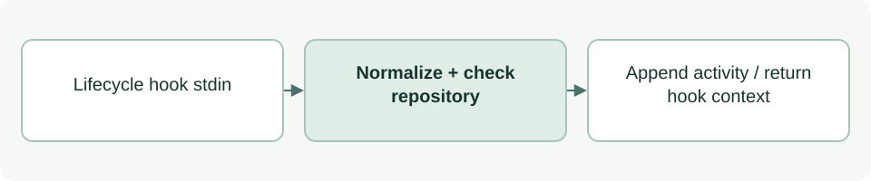

# Lifecycle logging adapter

[Source: agent_log_hook.py](agent_log_hook.py)

Receives lifecycle hooks, validates that they belong to the installed project and records permitted public activity.

## Responsibilities and collaborators

Owns stdin size limits, event normalization, repository confinement and the start-event logging notice.

- [agent_log_event](agent_log_event.md): Filters/redacts the public event.
- [agent_log_store](agent_log_store.md): Writes the JSONL history and derived session view.

## Interface and data

handle takes payload:dict and repo:Path (default installed root), returns a hook response dict. MAX_INPUT_BYTES is 1 MiB. main returns an integer process status.

| Callable or interface | Contract |
| --- | --- |
| `handle(payload, repo=REPO)` | Normalizes the payload, returns {} for ignored events, checks cwd inside repo, appends a record and supplies additionalContext on SubagentStart. |
| `main()` | Reads one bounded JSON payload, prints hook JSON and returns 0; prints a sanitized failure notice and returns 1 on exceptions. |

## Effects and failure behavior

Output root is derived from installation, never from payload data. Invalid cwd, oversized input and storage failures are reported without echoing payloads. Logging never grants work or approval permissions; its start notice preserves the shared documentation allowance and keeps log writes with the recorder.

## Example

The public `python3 asdg/scripts/hook.py log` entry forwards lifecycle hook input to this adapter.
