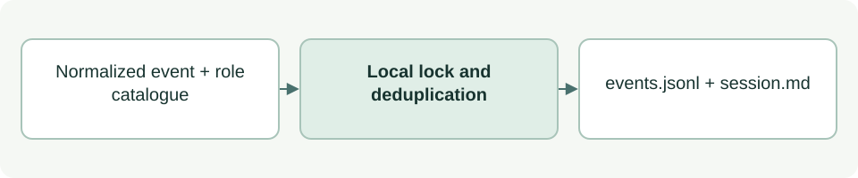

# Store per-agent activity

[Source: agent_log_store.py](agent_log_store.py)

Appends normalized agent events and maintains a compact human-readable session summary.

## Responsibilities and collaborators

Owns safe log directories, local-process locking, fingerprint deduplication, bounded history and atomic replacement of the derived view.

- [agent_log_event](agent_log_event.md): Defines the normalized input contract.
- [agent_log_hook](agent_log_hook.md): Calls the store after repository checks.

## Interface and data

record is a normalized event dict with agent identity, session/instance IDs and fingerprint. append_record returns (relative_summary_path:str, written:bool). MAX_LOG_BYTES is 4 MiB.

| Callable or interface | Contract |
| --- | --- |
| `utc_now()` | Returns a UTC ISO timestamp with millisecond precision. |
| `checked_path(repo, relative, create=False)` | Returns a validated directory Path; optionally creates missing directories with mode 0700. |
| `locked_log(path)` | Context manager yielding a locked text stream; enforces ordinary single-link files, size limit and a three-second lock timeout. |
| `markdown(rows)` | Returns a summary string for a nonempty list of recorded rows; includes the latest public self-report and recent observations. |
| `append_record(repo, record)` | Validates the role catalogue entry, appends a new fingerprint with sequence/time metadata and refreshes session.md even for duplicates. |

## Effects and failure behavior

Writes under logs/asdg/session/instance using 0600 files. Uses fcntl, so the implementation targets macOS/Linux. Locks are local, not cross-machine Drive locks; this is not tamper-proof storage. Invalid paths, full logs and lock timeouts raise exceptions.

## Example

`append_record(repo, normalized_event)` returns the session view path and whether an event was newly appended.
