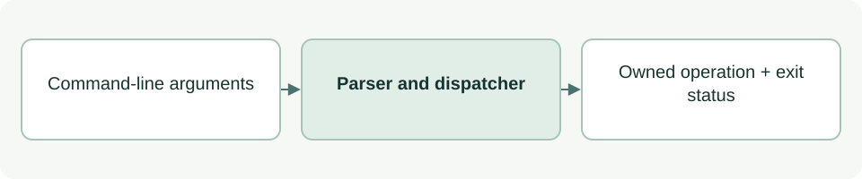

# ASDG command dispatcher

[Source: cli.py](cli.py)

Parses local ASDG commands, dispatches to the owning component and translates results into console or JSON output.

## Responsibilities and collaborators

Owns CLI argument validation, command routing and exit status; optional advice is imported only when requested by the selected mode.

- [cli_model](cli_model.md): Resolves the local Git root and catalogue.
- [cli_install](cli_install.md): One preview/explicit-apply engine for ZIP and pinned-clone acquisition.
- [cli_project](cli_project.md): Plans/verifies integration.
- [cli_status](cli_status.md): Evaluates facts.
- [cli_sprint](cli_sprint.md): Checks or changes sprint state.
- [cli_advice](cli_advice.md): Runs optional coordinator advice.
- [cli_advice_report](cli_advice_report.md): Saves verbose advice.
- [cli_dashboard](cli_dashboard.md): Serves the local dashboard.
- [cli_sync](cli_sync.md): Previews or explicitly applies promote/upgrade file synchronization between two Git roots.

## Interface and data

`argv` is list[str] or None (process arguments). main returns an integer exit status; argparse may raise SystemExit for help, version or invalid syntax.

| Callable or interface | Contract |
| --- | --- |
| `main(argv: list[str] \| None=None) -> int` | Dispatches init (with `--client codex\|claude\|both`), status, verify, next, dashboard, agent, sprint, promote and upgrade. Returns 0 for success and 1 for operational failure or conflicting synchronization preview. |

## Effects and failure behavior

Plain status may call the optional model runtime; status --json and --facts-only do not. init --apply and sprint start/stop write state; status --verbose can save reports. Known operational errors are caught and printed; permission to invoke a command remains separate.
Init defaults to preview, accepts --source/--commit/--target for a local clone, and requires --apply --plan after review; it dispatches before caller-root resolution.
Promote/upgrade require explicit source/target and either --dry-run or --apply; apply also requires --plan. These dispatch without resolving the caller's project or invoking agents.

## Example

`python3 asdg/scripts/cli.py status --facts-only` reads facts; `--help` lists the command interface.
