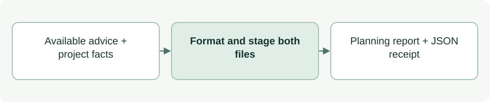

# Save coordinator advice for review

[Source: cli_advice_report.py](cli_advice_report.py)

Publishes a readable advisory report and its exact-content receipt under the project's Planning evidence.

## Responsibilities and collaborators

Resolves the canonical destination, formats bounded Markdown and publishes a receipt/document pair without overwriting an existing report.

- [cli_advice](cli_advice.md): Defines and validates response fields.
- [cli_project](cli_project.md): Validates the project binding.
- [cli_model](cli_model.md): Resolves Planning through the catalogue.
- [cli_files](cli_files.md): Checks destinations.
- [documentation](documentation.md): Checks length and builds receipts.

## Interface and data

Inputs are root/repo Paths, a factual status dict and validated available advice with runtime metadata. Report text is str; saved destination is Path.

| Callable or interface | Contract |
| --- | --- |
| `advice_destination(root: Path, repo: Path=REPO) -> Path` | Returns the bound Stage 07 root directory for `02.1-status-<time>-<id>.md` reports after catalogue, binding and path checks. |
| `render_report(root: Path, status: dict, advice: dict, saved_at: str) -> str` | Returns at most 50 nonblank lines of Markdown; validates advice and runtime presence. saved_at is accepted but not rendered. |
| `save_advice(root: Path, status: dict, advice: dict, repo: Path=REPO) -> Path` | Creates a unique timestamp/UUID report and JSON receipt, publishes receipt first, returns the Markdown Path and cleans its own failed partial writes. |

## Effects and failure behavior

Raises Conflict for unavailable/oversized advice or invalid destinations; filesystem errors propagate. Retries filename collisions three times. Private _wrapped normalizes/wraps prose. Reports are proposals and do not change lifecycle or sprint state.

## Example

The dispatcher invokes save_advice for `status --advise --verbose`; that option writes documentation.
