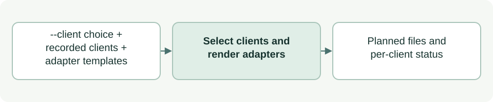

# Choose client integrations

[Source: cli_clients.py](cli_clients.py)

Decides which client integrations, Codex and Claude, a setup run installs, and renders Claude skill adapters from the same templates Codex uses.
The authoritative behavior is described in [client integrations](../../docs/client-integrations.md).

## Responsibilities and collaborators

Owns the client choice, the `.asdg/integrations.json` record, Claude adapter rendering and the Claude `@AGENTS.md` bridge. It writes nothing; the initializer plans and applies files.

- [cli_project](cli_project.md): Plans the returned files during setup and reports each client's status during verification.
- [cli_files](cli_files.md): Reads files safely; its `Conflict` reports invalid records and edited bridges.
- [cli_model](cli_model.md): Serializes the integration record as JSON.

## Interface and data

The record is `{"schema_version": 1, "clients": {"<client>": {"recorded_from": "..."}}}` with clients `codex` and `claude`.

| Callable or interface | Contract |
| --- | --- |
| `read_integrations(root) -> dict \| None` | Returns the validated record, or None when none exists; malformed records raise `Conflict`. |
| `resolve_clients(root, choice, installed) -> (recorded, applied, notes)` | Adds `choice` (`codex`, `claude`, `both`) to the record, records a legacy Codex installation explicitly, and returns the clients to plan; without a choice, the recorded clients, or Codex when none. |
| `integrations_bytes(recorded) -> bytes` | Deterministic, sorted JSON, so repeat setup writes nothing new. |
| `skill_names(repo)` / `explicit_only(repo, name)` | Public skills are templates containing `SKILL.md`; explicit-only means the Codex policy sets `allow_implicit_invocation: false`. |
| `claude_adapter(repo, name) -> bytes` / `claude_files(repo)` | Copies the template's name, description and body, adding `disable-model-invocation: true` for explicit-only skills. |
| `suppressors(root)` | Lists `CLAUDE.md`, `.claude/CLAUDE.md` or `CLAUDE.local.md` here or in parent folders. |
| `claude_bridge(root)` / `claude_bridge_problems(root)` | Returns the managed `@AGENTS.md` import to add only when a suppressor exists, or None; reports a missing or edited bridge. |

## Effects and failure behavior

Read-only. An existing import of `AGENTS.md` outside code counts as bridged, so no second import is added; an edited managed bridge or foreign symlink raises `Conflict`.
Rendering does not prove Claude registers the skills; native discovery is observed separately.

## Example

`python3 asdg/scripts/init.py --client claude --dry-run` lists the Claude adapters, any bridge and `.asdg/integrations.json` without writing.
