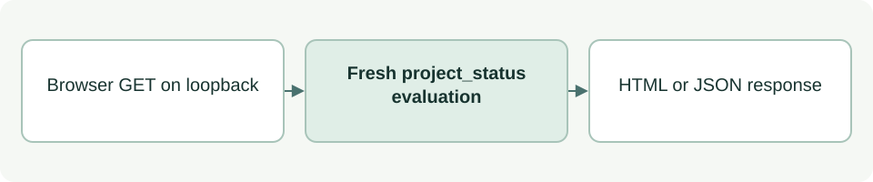

# Local project-status dashboard

[Source: cli_dashboard.py](cli_dashboard.py)

Presents the same factual project status as HTML and JSON through a loopback-only HTTP server.

## Responsibilities and collaborators

Owns display formatting and HTTP transport; delegates all readiness and permission decisions to the status evaluator.

- [cli_status](cli_status.md): Evaluates fresh status for each request and formats stage labels.
- [cli_model](cli_model.md): Supplies the embedded repository default.

## Interface and data

render_dashboard accepts a status dict and returns HTML:str. make_server returns ThreadingHTTPServer; root/repo are Paths and port:int defaults to 8765.

| Callable or interface | Contract |
| --- | --- |
| `render_dashboard(status: dict) -> str` | Escapes status values and produces responsive HTML with a 30-second refresh. |
| `make_server(root: Path, repo: Path=REPO, port: int=8765) -> ThreadingHTTPServer` | Binds 127.0.0.1, creates a private Handler for GET / and /status.json, and returns an unstarted server. |
| `serve_dashboard(root: Path, port: int=8765) -> None` | Runs the server until interrupted, prints its actual port and closes it on exit. |

## Effects and failure behavior

Handler rejects unexpected Host values (403) and paths (404), disables caching and sends a restrictive CSP. It has no write endpoint, model call or remote binding. Socket errors may propagate; KeyboardInterrupt ends serving normally.

## Example

`python3 asdg/scripts/cli.py dashboard --port 8765` starts the read-only local view; port 0 requests an available port.
