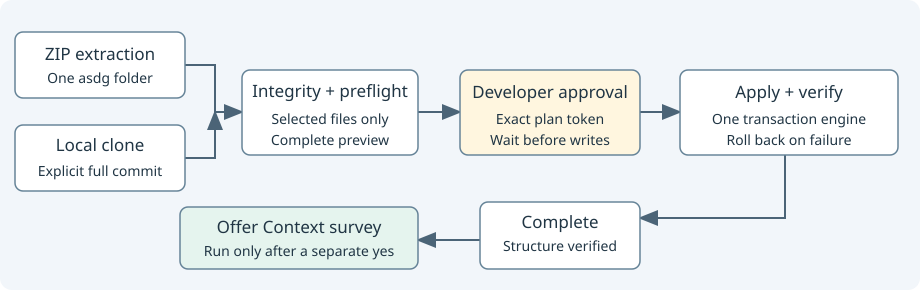

# Deterministic project installation

[Source](cli_install.py). One engine plans both extracted packages and verified local clones.

## Responsibility and collaborators

`cli_install_source` checks package hashes and clone identity; `cli_project` plans integrations and scaffolds; `cli_files` owns collision checks and rollback.
Both acquisition paths normalize only selected distribution members into a temporary directory so provider-only templates cannot enter generated integrations.

| Interface | Contract |
| --- | --- |
| `install(...)` | Defaults to preview. Accepts source/commit for a clone, target, client, initial status, apply_changes and expected_plan. Returns source identity, every distribution file, generated diffs, planned paths and verification results. |
| `render(report)` | Shows the full plan or completion, native-test limits and a `/asdg-status` handoff; it never runs Status or creates chats. |

The timestamp in the plan token freezes generated timestamps across preview and apply. Replanning hashes source bytes, target Git identity, destination bytes, client choice and initial status; changed inputs require another preview.
No plan file is written. Temporary normalization is removed after both preview and apply; target and source are unchanged during preview.
The token identifies reviewed bytes; it is not human authentication or methodology approval. Prompts must wait for explicit developer approval.
Missing approval tokens, collisions, stale manifests, mismatched commits and incompatible bindings fail before target writes. Verification runs inside the existing rollback boundary.
Integrity and structure are deterministic checks; native application discovery, invocation and hook trust remain unverified.
After successful application the console points to `/asdg-status`; that conversational skill owns the assessment and any Create team suggestion. Init never invokes Status, creates chats or starts analysis. The legacy `context_survey` JSON object remains for compatibility with `offered` and `executed` false.
