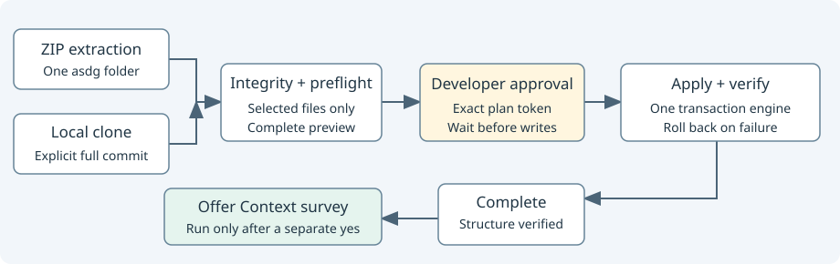

# Installation source verification

[Source](cli_install_source.py). Freeze only the selected portable distribution before planning initialization.

| Interface | Responsibility |
| --- | --- |
| `git_root(path, exact=True)` | Require an existing Git root; caller-directory discovery may allow a subdirectory. Never creates a repository. |
| `package(repo)` | Read selected regular files, restrict methodology paths, validate descriptor/version and exact manifest hashes. Return provenance and frozen bytes. |
| `source_snapshot(repo, commit)` | For clones, also require an explicit full commit matching HEAD, normalized canonical origin and regular-file Git blob equality for every selected member. |

Collaborates with `distribution_files`, `cli_project.distribution`, `cli_sync_manifest` path/identity normalization and `cli_files` safe reads.
Unselected provider files and their local edits are excluded. Selected dirty or untracked files fail even when a locally refreshed manifest matches them.
Source Git operations are read-only. Integrity does not establish release approval or external authenticity; the developer selects and reviews the source and commit.
ZIP acquisition uses an already extracted single `asdg/` folder; the engine neither downloads nor extracts archives.
Conflicts and Git/filesystem failures stop installation. No application, provider project state or Git metadata is copied.
