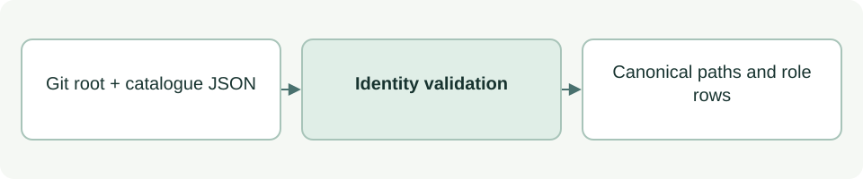

# Project identity and role catalogue

[Source: cli_model.py](cli_model.py)

Provides the shared identity, paths and catalogue lookup used by the local ASDG tools.

## Responsibilities and collaborators

Resolves the embedded project root through Git and validates the thirteen canonical role identities.

- [cli_files](cli_files.md): Checks catalogue and metadata paths; supplies Conflict.

## Interface and data

Catalogue rows are dictionaries with stage, native_name, role_id, folder, entry and title. Constants include REPO, VERSION, CATALOG, ARTIFACTS and BINDING. The legacy PERSPECTIVES mapping still names intended/planned; current folder creation is owned by cli_project.
VERSION is `0.3.0-pilot.3` and matches the candidate in `metadata/distribution.json`; an older client binding is refused until a reviewed upgrade reconciles it.

| Callable or interface | Contract |
| --- | --- |
| `require_python() -> bool` | Returns whether Python is at least 3.9; prints a diagnostic to stderr otherwise. |
| `now() -> str` | Returns a UTC ISO timestamp ending in Z. |
| `sha(data: bytes) -> str` | Returns the SHA-256 hexadecimal digest of bytes. |
| `json_bytes(value: object) -> bytes` | Serializes JSON as UTF-8, indented and newline-terminated. |
| `catalogue(repo: Path=REPO) -> tuple[list[dict], str]` | Returns stage-sorted role dictionaries and the raw catalogue hash; validates version, count, paths and identities. |
| `git_value(root: Path, *arguments: str) -> str \| None` | Runs git -C with a ten-second timeout; returns stripped stdout on success or None for a nonzero exit. |
| `project_root(cwd: Path \| None=None, repo: Path=REPO) -> Path` | Returns the resolved Git root only when it matches this embedded distribution and contains its metadata. |
| `agent_by_name(name: str, repo: Path=REPO) -> dict` | Finds a role by native name, stable ID, stage or supported architect/coordinator alias. |

## Effects and failure behavior

Malformed catalogue/root data raises Conflict or parse errors. Missing Git and timeouts become Conflict. The module reads local files and launches read-only Git inspection.

## Example

`agent_by_name('02')` returns the Purpose role definition; it does not activate an agent.
