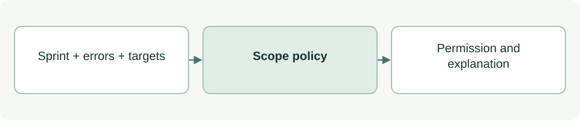

# Implementation permission calculation

[Source: cli_policy.py](cli_policy.py)

Makes the scope decision shared by status and guards without reading or writing files itself.

## Responsibilities and collaborators

Blocks on project errors or inactive sprints and checks every requested target against active scope.

- [cli_sprint](cli_sprint.md): Normalizes paths and rejects protected targets; supplies the inactive-sprint reason.

## Interface and data

Result dict: permission:string, allowed:bool|None, reason:string, requested_paths:list[str]|None, scope:list[str]. allowed=None means an active sprint exists but no concrete target set was supplied.

| Callable or interface | Contract |
| --- | --- |
| `implementation_permission(root: Path, sprint: dict \| None, errors: list[str], paths: list[str] \| None=None) -> dict` | Returns BLOCKED, ALLOWED_WITHIN_SCOPE or ALLOWED for the supplied root, sprint, errors and target list. None requests general status; [] is an invalid empty target check. |

## Effects and failure behavior

Path validation failures become BLOCKED results. Callers must supply trustworthy, validated sprint/error data; this calculation is not an authorization source.

## Example

`implementation_permission(root, sprint, [], ['app.js'])` checks that one concrete file is in scope.
