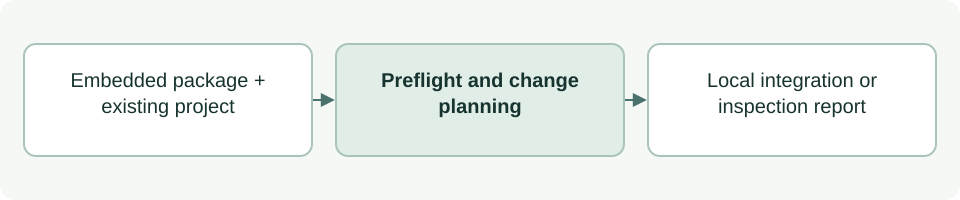

# Initialize and inspect an embedded project

[Source: cli_project.py](cli_project.py)

Plans project-local ASDG integration while preserving existing work and state, and reports whether that integration remains structurally consistent.

## Responsibilities and collaborators

Owns initialization preflight, managed file plans, discovery-template copying, stage scaffolds and structural inspection.

- [cli_files](cli_files.md): Plans conservative writes; [cli_install](cli_install.md) owns explicit application and verification.
- [cli_model](cli_model.md): Supplies identities, catalogue, JSON and hashes.
- [cli_sprint](cli_sprint.md): Validates existing sprint state.
- [cli_status](cli_status.md): Validates lifecycle rules/state through local imports.
- [documentation](documentation.md): Counts source lines and records document hashes.
- Stage introductions in `asdg/scaffolds/stages/`: generic human explanations and embedded diagrams, copied only when the client README is absent.

## Interface and data

Inputs are project/repository Paths and optional project_state (`new`, `defining`, `defined`). Planning returns a report dictionary plus Change objects; the installation engine adds dry-run, apply and verification results. Initialization creates stage introductions only; numbered evidence and plan files are added when needed. Structural inspection requires stage READMEs, not perspective directories.

| Callable or interface | Contract |
| --- | --- |
| `distribution(repo)` | Reads and validates embedded metadata; returns its dictionary. |
| `stage_readme(repo, slug) -> bytes` | Reads a packaged stage introduction; rejects missing files or documents over 50 nonblank lines. |
| `hook_config(root, repo=REPO)` | Returns JSON bytes for the configured guard and lifecycle logging hooks; does not establish trust. |
| `merge_block(old, block, begin, end, name)` | Returns preserved/extended bytes for an appended managed text block, such as `.gitignore`; rejects edited or incomplete blocks. |
| `bootstrap_is_current(text: str) -> bool` | True when the text begins with `BRIDGE` and contains no other managed markers; used by setup and `inspect`. |
| `merge_bootstrap(old) -> bytes` | Returns root `AGENTS.md` with `BRIDGE` first and all other text kept byte-for-byte; moves an exact `LEGACY_BRIDGES` block to the top, removing the one separator newline older setups added; rejects edited, moved, duplicated or linked blocks and YAML-first files. |
| `binding(root, catalog_hash)` | Validates project identity/catalogue/layout; returns the binding dict or None. A version/catalogue mismatch requires a matching explicit upgrade receipt from [sync metadata](cli_sync_manifest.md), preserving the original binding. |
| `template_files(repo)` | Returns relative template paths and bytes; rejects symlinks and unexpected destination roots. |
| `client_files(root, repo, client)` | Returns the managed files for one client: Codex hooks, config and templates, or rendered Claude skill adapters. |
| `client_report(root, repo, installed)` | Returns each client's selection, `NOT_SELECTED`, `COMPLETE` or `DAMAGED` status, problems and `runtime: NOT_VERIFIED`, plus all problems. |
| `preflight_package(repo)` | Checks thirteen role definitions/adapters, the separate Admin package through `cli_session.validate_admin`, and exactly one shared Focus picker template; rejects missing metadata or retired per-role Focus templates. Returns agents and catalogue digest. |
| `plan_initialization(root, repo=REPO, project_state=None, client=None, timestamp=None, source=None)` | Returns report and Change objects for shared files, selected clients, bridges and receipts; never writes. A supplied timestamp freezes generated content; portable provenance records version/commit/hashes without an absolute source path. |
| `inspect(root, repo=REPO)` | Returns structure_ok, missing items, binding/version details, sprint state and per-client `integrations`; a damaged selected client fails the structure, an unselected one does not. |

## Effects and failure behavior

Conflicts stop initialization rather than overwriting edited integration. Existing lifecycle/sprint records are preserved. New setup records an inactive sprint; it grants no implementation permission.
`BRIDGE` is a seven-line bootstrap that only requires reading `asdg/AGENTS.md` and its startup sources and blocks dependent work if one is missing; shared rules live under `asdg/`, and it holds no project-specific text.
`LEGACY_BRIDGES` holds the three exact earlier appended blocks; repeat setup moves an unedited one to the top with a backup of the old file, and `inspect` requires the current block first and only once. Initialization itself creates no substantive deliverable or transition.
Discovery templates include ASDG Decision; existing customized adapters remain conflicts requiring explicit reconciliation.

## Example

From the client root: `python3 asdg/scripts/init.py --dry-run` previews writes.
