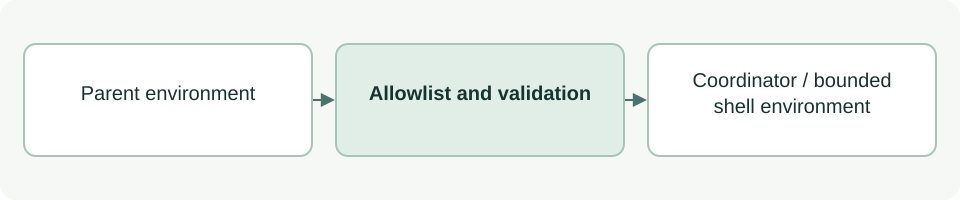

# Bounded coordinator environment

[Source: cli_runtime_env.py](cli_runtime_env.py)

Constructs the environment passed to the optional coordinator process and its shell tools.

## Responsibilities and collaborators

Forwards only selected execution, location, locale and public-certificate settings, while relying on persisted login for authentication.

- [cli_files](cli_files.md): Provides Conflict for an unavailable configured Codex state directory.
- [cli_advice](cli_advice.md): Consumes these environment/configuration values when starting the runtime.

## Interface and data

ENV_NAMES is the allowlist. Parent input is a mapping of environment names to string values. Return values are either dict[str,str] or a Codex configuration override string.

| Callable or interface | Contract |
| --- | --- |
| `subprocess_environment(parent: dict \| None=None) -> dict[str, str]` | Returns allowlisted values with PATH/HOME fallbacks and PYTHONDONTWRITEBYTECODE=1; validates optional CODEX_HOME. |
| `shell_environment_policy() -> str` | Returns a full replacement shell_environment_policy TOML expression with inherit=none; omits CODEX_HOME from shell-tool variables. |

## Effects and failure behavior

A relative or unavailable CODEX_HOME raises Conflict. Environment-only API keys and tokens are intentionally not forwarded. This module returns configuration and does not itself start a process.

## Example

`subprocess_environment({'PATH': '/usr/bin', 'SECRET': 'example'})` excludes SECRET.
