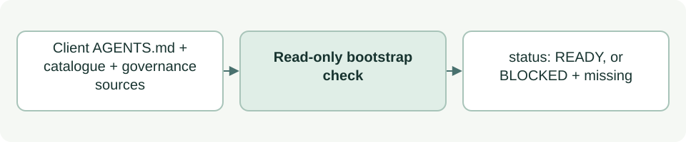

# Check the default session role and the Admin package

[Source: cli_session.py](cli_session.py)

Every ASDG session acts under an accountable role, and 00 Governance (`ASDG-COORDINATOR`) is the default.
This module answers one factual question for `status`: are the files a new session must read before starting under that role actually present?

## Responsibilities and collaborators

Owns the list of governance bootstrap sources and the READY/BLOCKED result, and validates the separate ASDG Admin package. It does not select, store or enforce a role; conversation receipts hold role state.

- [cli_model](cli_model.md): Supplies the validated agent catalogue, which locates the coordinator's entry, contract and procedure.
- [cli_files](cli_files.md): Reads files safely inside the client and distribution roots.
- [cli_status](cli_status.md): Includes the result as `session_governance` and treats BLOCKED as an error.
- [cli_hook](cli_hook.md): Denies every write, documentation included, while the bootstrap is BLOCKED.
- [cli_project](cli_project.md): Calls `validate_admin` during package preflight, so setup and `verify` fail on an invalid Admin package.

## Interface and data

| Callable or interface | Contract |
| --- | --- |
| `DEFAULT_ROLE` | `'ASDG-COORDINATOR'`, the catalogue ID of the default role. |
| `SHARED_SOURCES` | Distribution-relative paths every session reads: `asdg/AGENTS.md`, session policy and state, runtime contract and response envelope. |
| `validate_admin(repo: Path=REPO) -> dict` | Checks `asdg/admin/types/admin-role.json`: valid JSON, exact fields, fixed identity, explicit-only activation, not default, no native adapter, non-empty selectors, and entry/contract/skill files inside `asdg/admin/` via `safe_path`. Raises `Conflict` naming the first problem. |
| `entry_point_loads_distribution(agents: bytes \| None) -> bool` | True when the first ASDG-managed block references `asdg/AGENTS.md`. |
| `governance_bootstrap(root: Path, repo: Path=REPO) -> dict` | Returns `default_role`, `native_name`, `label`, `role_none_permitted` (always false), `status`, `blocked_code`, `missing` and `enforcement`. |

The root `AGENTS.md` must contain an ASDG-managed block, current or legacy, that references `asdg/AGENTS.md`; a mention in project-owned text does not count. The coordinator's entry, `types/contract.md` and procedure come from the catalogue.
`status` is `READY` when nothing is missing, otherwise `BLOCKED` with `blocked_code` `GOVERNANCE_BOOTSTRAP` and one message per gap.

## Effects and failure behavior

Read-only: no writes, model calls or role changes. A missing or malformed catalogue becomes a `missing` entry, not an exception.
`enforcement` is `INSTRUCTIONAL_ONLY`: presence of the files does not prove that an agent read them or acted under the role.
The check confirms presence, not content; a contradictory instruction still needs human or agent review.

## Example

`python3 asdg/scripts/cli.py status --json` includes `"session_governance": {"status": "READY", ...}` in a correctly installed client.
Deleting `asdg/00-governance/types/contract.md` turns it to `BLOCKED`, adds an error and blocks implementation permission.
