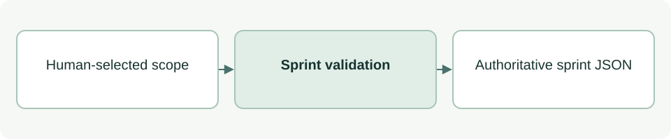

# Sprint state and scope

[Source: cli_sprint.py](cli_sprint.py)

Maintains the single active sprint record and exposes the implementation check used by callers.

## Responsibilities and collaborators

Validates scope paths, reads sprint state and performs explicitly requested start/stop transitions.

- [cli_files](cli_files.md): Checks paths and applies state writes.
- [cli_status](cli_status.md): Evaluates implementation permission through a local import.
- [cli_model](cli_model.md): Serializes state JSON.

## Interface and data

Sprint dict: status, sprint_id, objective, scope:list[str], acceptance_criteria:list[str]. Inactive state has null identity/objective and empty lists. Scope is an exact file or a directory ending in `/`.

| Callable or interface | Contract |
| --- | --- |
| `relative_path(root: Path, value: str) -> str` | Normalizes a target to a repository-relative string; rejects traversal, wildcards, symlinks and protected governance paths. |
| `validate(root: Path, value: object) -> dict` | Returns a valid active/inactive state dict or raises Conflict. |
| `read_state(root: Path) -> dict` | Reads .asdg/sprint.json and validates it; missing state is a conflict. |
| `check_implementation(root: Path, paths: list[str], repo: Path \| None=None, guidance: bool=False) -> tuple[bool, str]` | Returns (allowed:bool, reason:str) from the shared status evaluator; optional guidance adds the next action. |
| `start(root: Path, sprint_id: str, objective: str, scope: list[str], criteria: list[str]) -> dict` | Requires inactive state, validates the supplied identity/objective/scope/criteria, writes active state and returns it. |
| `stop(root: Path) -> dict` | Validates existing state, writes INACTIVE and returns a copy. |

## Effects and failure behavior

start/stop mutate .asdg/sprint.json and require an explicit human decision. Stopping does not itself verify results, consolidate documentation or clean completed plans. The check returns False on supported validation failures.

## Example

Read with `python3 asdg/scripts/cli.py sprint status --json`; pass each target to `sprint check-implementation --path app.js`.
