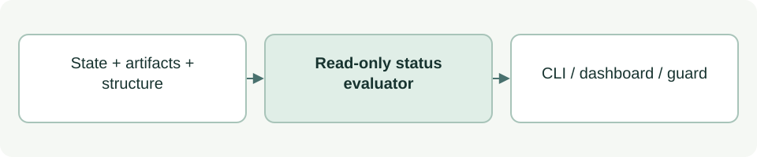

# Evaluate project status

[Source: cli_status.py](cli_status.py)

Builds the factual project snapshot shared by the CLI, dashboard and implementation guard.

## Responsibilities and collaborators

Combines structure, lifecycle evidence, review freshness and sprint scope into one read-only status result.

- [cli_project](cli_project.md): Inspects installed structure.
- Exact comparison with the packaged Context introduction recognizes new scaffolding; legacy scaffolds remain supported and edited introductions count as content.
- [cli_policy](cli_policy.md): Computes scope permission.
- [purpose_review](purpose_review.md): Checks Purpose acceptance.
- [stage_review](stage_review.md): Checks other stage acceptance.
- [cli_model](cli_model.md): Provides identities and time.
- [cli_session](cli_session.md): Checks that the default 00 Governance role's sources are present.

## Interface and data

Lifecycle data is schema_version:1 with stages keyed by two-digit strings. Stage entries carry artifacts, not_applicable_reason and optional reviews. Status includes lifecycle_stages, errors, implementation, guard, session_governance and recommendation; a BLOCKED governance bootstrap adds errors and so blocks implementation. Readiness and human acceptance remain separate fields.

| Callable or interface | Contract |
| --- | --- |
| `lifecycle_rules(repo: Path) -> list[dict]` | Returns ordered rules joined to the canonical catalogue and lifecycle labels; rejects inconsistent identities. |
| `read_lifecycle(root: Path, rules: list[dict]) -> dict` | Reads and validates lifecycle JSON, stage artifact paths and review histories. |
| `context_is_empty(root: Path, rule: dict) -> bool` | Returns whether Context contains only recognized scaffolds/empty files; symlinks and substantive unregistered work count as content. |
| `evidence_status(root: Path, rules: list[dict], value: dict) -> list[dict]` | Returns per-stage evidence and completion results, including derived empty Context acceptance when Purpose acceptance is current. |
| `recommendation(stages: list[dict], sprint: dict \| None, errors: list[str]) -> dict` | Returns a deterministic suggestion from errors and earliest missing evidence; it is not a human priority decision. |
| `project_status(root: Path, repo: Path=REPO, requested_paths: list[str] \| None=None) -> dict` | Returns the complete snapshot for root/repo and optional requested implementation paths; collects structural errors. |
| `stage_label(stage: dict \| None) -> str` | Formats a stage number and name, or UNKNOWN. |
| `render_status(status: dict) -> str` | Formats the factual snapshot for console output, including each client integration's status; the guard reads `NOT_INSTALLED` when Codex is not selected. |
| `render_next(status: dict) -> str` | Formats the deterministic next-action guidance and any implementation block. |

## Effects and failure behavior

Read/validation failures appear in errors and block implementation. Missing evidence does not prove no work exists. Hook trust remains unknown unless separately established; this module performs no model call or state write.

## Example

`python3 asdg/scripts/cli.py status --json` exposes the factual snapshot without coordinator advice.
