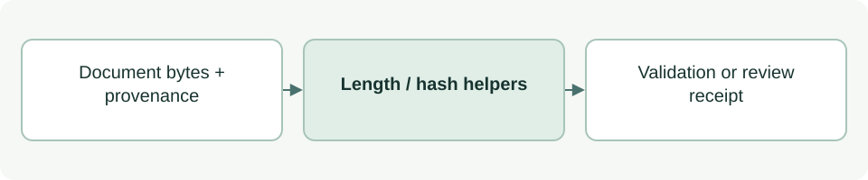

# Documentation length and review receipts

[Source: documentation.py](documentation.py)

Provides shared checks for compact Markdown and exact-content records of documentation changes.

## Responsibilities and collaborators

Counts nonblank lines, constructs modification receipts and checks whether a provider document has a matching receipt.

- [cli_project](cli_project.md): Records generated documentation changes.
- [cli_advice_report](cli_advice_report.md): Records saved advice.
- [check](../check.md): Uses the shared line counter.

## Interface and data

MAX_NONBLANK_LINES is 50. Receipt dictionaries contain path, sha256, event, recorded_at, human_approval:null and provenance; an optional previous_state retains the old hash and visible markers.

| Callable or interface | Contract |
| --- | --- |
| `nonblank_source_lines(text: str) -> int` | Returns the count of source lines containing non-whitespace characters. |
| `check_length(text: str) -> None` | Returns None or raises ValueError above the source-line limit. |
| `review_record(path: str, before: bytes \| None, after: bytes, recorded_at: str, **provenance) -> dict` | Returns an AI-MODIFIED receipt from before/after bytes and caller-supplied time/provenance; does not save it. |
| `recorded_document(root: Path, path: Path) -> bool` | Returns whether the current provider document bytes match a qualifying event in the provider review ledger. |

## Effects and failure behavior

Receipts do not authenticate a human or transfer approval. recorded_document returns False for missing, malformed or unsafe ledger cases; line count does not establish readability. The caller owns ledger writes.

## Example

`check_length(markdown)` validates size; `review_record(path, before, after, timestamp)` prepares the event to append.
