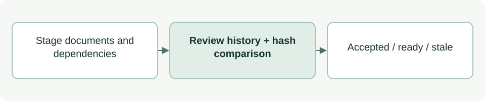

# Review other stage documents

[Source: stage_review.py](stage_review.py)

Checks documentation acceptance outside Purpose while binding the review to local documents and their linked stage assets.

## Responsibilities and collaborators

Validates owning-role readiness and User acceptance, traverses inline local Markdown dependencies, and detects stale bundles.

- [cli_files](cli_files.md): Rejects unsafe paths and reads files.
- [cli_status](cli_status.md): Reports stage completion.
- [purpose_review](purpose_review.md): Owns the separate, stronger Purpose-specific contract.

## Interface and data

number is a two-digit stage string; prefix is its repository-relative Path. Entry contains artifacts:list[str] and optional reviews. Events use decision, actor, recorded_at, artifacts hashes, and criteria or statement.

| Callable or interface | Contract |
| --- | --- |
| `validate_reviews(reviews: list, number: str, prefix: Path) -> None` | Checks schema, stage-local hash paths, owning ASDG-NN readiness criteria and matching prior readiness for acceptance. |
| `bundle_hashes(root: Path, files: list[str], prefix: Path) -> dict[str, str]` | Returns a sorted path→SHA256 map including optional README and transitively linked assets inside prefix; validates outgoing local links without approving their content. |
| `completion_status(root: Path, entry: dict, number: str, prefix: Path) -> dict` | Returns completion flags/status/reason by comparing current bundle hashes with the latest reviewed version. |

## Effects and failure behavior

Rejects duplicate or empty artifact lists, escaping/symlink paths and remote or undescribed images. Only inline Markdown links are traversed. Reads do not write state or prove human identity.

## Example

`bundle_hashes(root, files, Path('docs/asdg/03-system-model-and-use-cases'))` captures the stage bundle.
