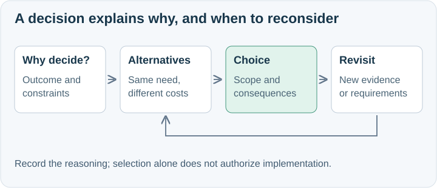

# Learn the pattern from the SpeakerCoach decision

SpeakerCoach's “Use Open AI Agent SDK” package is the motivating example selected by the user.
The reusable lesson is to connect a choice to the current outcome, compare responsibilities fairly, and make future reconsideration possible.

## What the example demonstrates

The immediate outcome was retaining an interview question with timely visual help.
The existing implementation already used the OpenAI Agents SDK, so migration needed a concrete benefit.
Two introductory documents explained the bounded POC choice and comparison method; individual product notes explained fit, trade-offs, and revisit triggers.
The notes separated agent frameworks from realtime media services and evaluation tools, so complementary tools were not dismissed as losing alternatives.
Each substantive document embedded an editable diagram and linked evidence; the decision did not claim comparative benchmarks or production readiness.

In the originating client, the example is at:
`docs/asdg/05-high-level-design-and-architecture/decisions/Use Open AI Agent SDK/`.
Inspect it when present and relevant. This portable skill must also work without that folder, the SpeakerCoach application, or any machine-specific path.
Its twelve products, two introductions, dates, provider choice, and Node.js stack are examples, not requirements.

## Apply the same method to a non-product decision

For “Keep accepted session state in the local service,” compare local service ownership, browser ownership, and hosted ownership.
Explain which failures and consistency requirements matter, who accepts updates, and how reconnection works.
Use diagrams showing authority and message flow, not vendor logos.
A small package could contain a decision summary and three option notes; add a comparison introduction only when it improves understanding.
If the user has selected nothing, preserve that uncertainty and recommend the next evidence rather than declaring a winner.
A later multi-device requirement could be a revisit trigger; do not invent that requirement or an implementation commitment.

[Package format](record-format.md) · [Skill](SKILL.md)

