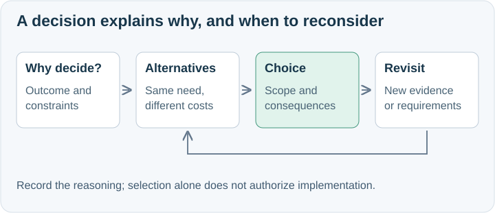

# A decision package readers can understand

One material decision gets one named folder, one or two introductory documents, and short assessments of its meaningful alternatives.
Use this format for boundaries, deployment, data ownership, interaction patterns, reliability, security, and build-versus-buy choices as well as products.

## Location and reading order

Honor the owning contract's existing artifact format and destination; integrate decision reasoning there when it prescribes a different layout. Otherwise use a named decision package within authorized scope.
ASDG-05 defaults to `docs/asdg/05-high-level-design-and-architecture/decisions/<Decision name>/`; other roles use their own stage destinations under the shared documentation authority.
Honor a supplied safe folder name; otherwise use a descriptive decision title. Search existing decisions first and avoid duplicates.
For an undecided question, use a neutral title. A later choice can update the record without silently moving it or breaking links.
This is a topic-folder exception to the shared flat stage layout; its numbered filenames express reading order, not Intended/Actual/Planned categories.

| File | What the reader learns |
| --- | --- |
| `README.md` | Decision/question, status, scope, why it matters, choice or recommendation, consequences, and navigation. |
| `01-comparison.md` when useful | Context, decision drivers, comparable options, evidence, uncertainties, and reasons for the choice. |
| One short document per meaningful option | Responsibility, fit, trade-offs, why selected/deferred, and conditions for reconsideration. |
| `images/` | Editable sources of diagrams embedded in the relevant documents. |

Scale the package to the decision; combine introductory material when small and do not create filler options.
Give each substantive explanation a useful visual of behavior, boundaries, relationships, failure paths, or evidence.
A comparison/status table alone is not the explanatory visual. Navigation-only indexes retain the shared exception.
Keep every Markdown unit within 50 nonblank source lines, with readable paragraphs and spacing.

## Decision integrity and delivery

Record proposed, selected, deferred, or superseded status in prose, identifying the actual basis and known date.
State the selected scope/horizon and material consequences, including obligations and accepted trade-offs.
Link evidence and related decisions; retain uncertainty and absent measurements. Do not fabricate consensus, scores, approvals, or implementation results.
Capture concrete revisit triggers and the observation or experiment that could change the choice.
When revising, retain the earlier decision and explain what evidence changed; preserve existing review history and registered artifact bytes unless the task calls for edits.
Check local links, source length, and every new/changed diagram at realistic document width; inspect representative complete rendered pages.
Record each document's visual, explanatory purpose, and actual inspection result with its hash-bound AI modification receipt under the [documentation standard](../../00-governance/docs/documentation-standard.md).
Use the [review criteria](../../00-governance/docs/documentation-review.md); report specific unavailable checks. A document saved is not a human-approved baseline.

