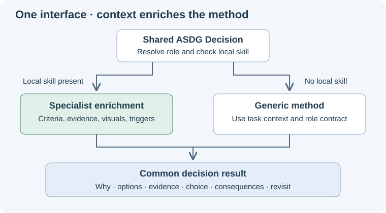

# One decision method, optional specialist enrichment

Every ASDG role can use the shared Decision method. A specialist needs a local method only when recurring domain guidance adds value.
This is instruction-level dispatch: the shared skill explicitly reads the local file; folder placement does not create a native runtime override.

## Resolve the method

Use the selected specialist or explicit role assignment to find its canonical `folder` in the existing agent catalogue.
Check exactly `<folder>/skills/decision/SKILL.md`, relative to the bound client root, independently of the terminal working directory.
If present, read it and its required references once, then continue the shared workflow with its enrichments. The local method must not recursively invoke the shared entrypoint.
If absent, apply the generic method using the task, domain evidence and role contract; absence is normal and creates no file or warning.
With no selected or assigned role, use the generic method provisionally; do not invent a specialist or change Focus.
If a local file exists but is invalid, cannot be read or contradicts the shared contract, report the specific gap; do not silently treat it as absent.

## Shared interface and extension points

Input is the current decision, project, role, requested action, constraints, evidence and explicit human choices.
The shared workflow owns purpose, alternatives, evidence distinctions, recommendation/selection, consequences and revisit conditions.

| Optional local enrichment | What the specialist supplies |
| --- | --- |
| Frame the decision | Domain responsibilities and relevant alternatives. |
| Evaluate alternatives | Domain criteria, evidence requirements and common analytical mistakes. |
| Explain the result | Useful domain visuals and details within the shared documentation standard. |
| Revisit the choice | Domain-specific changes or observations that warrant reassessment. |

Unspecified extension points inherit generic behavior. A local method need not repeat the common workflow or implement every extension point.
Every method returns the same decision meaning: rationale, comparable options, evidence/uncertainty, choice status, consequences and revisit conditions.
Return analysis or save authorized documentation according to the request and owning contract; neither the method nor its result approves execution.

## Maintaining a specialization

Use a real `skills/decision/SKILL.md` folder/file with YAML-first `name: decision` and a domain-specific description.
This is a role-local resource loaded by the shared entrypoint, not another globally registered `$asdg-decision` command.
A specialist may propose enrichment when the generic method is insufficient; create or update it within an authorized methodology-maintenance task.
Keep only meaningful differences, link domain foundations, and test the changed behavior. Do not generate empty methods for every role.
Local methods may refine criteria and presentation but cannot remove shared evidence obligations, change Focus, widen writes, or alter approval rules.
The [architecture specialization](../../05-high-level-design-and-architecture/skills/decision/SKILL.md) demonstrates this extension point; other roles may keep the generic method.
