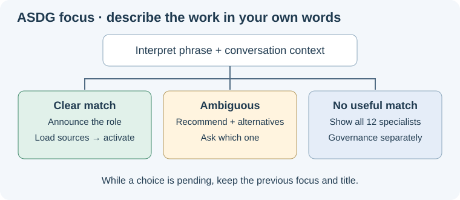

# Interpret the user's Focus request

The [catalogue](../../00-governance/types/agent-catalog.json) owns role identities, paths and procedures; the table below explains their responsibilities.
The short labels below are the session-name vocabulary; canonical IDs, responsibilities, folders and legacy role-name selectors remain unchanged.
Explicit within-role topics use [subject focus](subject-focus.md); do not silently reinterpret a legacy role request.
Use the complete phrase and relevant conversation context, including negation and distinctions such as strategy versus execution.
These are examples of meaning, not a keyword parser or an exhaustive list of accepted phrases. Tolerate ordinary spelling mistakes.

## Resolve or clarify

A clear request such as “focus on high level architecture” selects 05; “specify the exact API inputs and errors” fits 08.

For overlapping meanings, inspect the plausible roles' responsibilities; do not invent a confidence percentage or let one keyword decide.
If ambiguity remains, ask which specialist the user wants. Offer the strongest candidate as Recommended with a short reason, then the relevant alternative(s).
For “focus on testing” without further context, distinguish 04's evaluation strategy from 09's build/test work; explain the recommendation as provisional.
Use a clarification tool when available, otherwise ask in the reply. Wait for an answer; a default selection or elapsed time is not consent to switch.

If no useful match exists or the phrase is missing, ask “Which specialist would you like to focus on?” and show all twelve choices below, with Governance separately.
Keep the prior focus and title during clarification. The answer resolves the pending selection while preserving the original task.

A clear match needs no extra confirmation; announce the interpretation, load required sources, and claim activation only after those reads succeed.
Role IDs/numbers/native names remain optional shortcuts. Explicit conflicting roles require clarification; do not treat a mentioned comparison partner as a second selection.

A quoted example, hypothetical question or request to explain Focus does not activate it. Never turn user text into a filesystem path or shell command.

## Twelve specialist choices

| Stage | Short role label | Responsibility and example intent |
| --- | --- | --- |
| 01 | Context | Understand the domain, stakeholders, terminology and source context. |
| 02 | Purpose | Clarify why the system exists, intended outcomes, scope and non-goals. |
| 03 | UseCases | Model actors, domain concepts, scenarios and observable interactions. |
| 04 | EvalStrategy | Choose evaluation methods, benchmarks, measures and success criteria. |
| 05 | Architecture | Decide system boundaries, components, deployment and major trade-offs. |
| 06 | POC | Design a bounded experiment to resolve a specific uncertainty. |
| 07 | Planning | Sequence scoped work, dependencies and handoffs. |
| 08 | Specs | Specify detailed interfaces, contracts, edge cases and component behavior. |
| 09 | Coding | Assess or perform separately authorized component implementation and tests. |
| 10 | ReviewQA | Review an exact candidate, documentation and release readiness. |
| 11 | Operations | Assess real environments, rollout, recovery and acceptance evidence. |
| 12 | Observability | Interpret telemetry and feedback to propose learning and improvements. |

Separately offer **00 Governance** for whole-project coordination, responsibility routing and review gates; its canonical role is ASDG-COORDINATOR and the default.
An explicit “clear focus,” “stop specializing,” or “return to general” returns to 00 Governance.
**ASDG Admin** (`ASDG-ADMIN`, [registration](../../admin/types/admin-role.json)) maintains ASDG rules; it is outside the lifecycle and never offered as a default.
Select Admin only from an explicit human selector listed in its registration, including its dedicated [`$asdg-admin`](../asdg-admin/SKILL.md) skill; a topic such as “rules” or “policy” never selects it.
All choices retain their role contracts. Selecting Build/Test or Operations does not itself authorize implementation or deployment.
