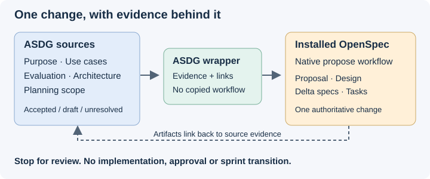

# Propose a change from ASDG evidence

Use this wrapper when the user requests an ASDG-grounded OpenSpec proposal. It connects existing decisions to one proposed change, without replacing specialist ownership.
`$asdg-openspec-propose <change description or name>` is a skill invocation, not a new terminal subcommand.
Existing `asdg-prepare-plan`, `asdg-propose-architecture` and native `openspec-propose` keep their meanings.

## Establish the boundary and inputs

Read client instructions and [session policy](../asdg-focus/session-policy.md); preserve role, subject, attitude and goal. Only ASDG-08 may write native artifacts under the [OpenSpec exception](../../00-governance/docs/write-exceptions.md); other roles return a proposal/handoff.
Resolve the ASDG client root from this canonical directory as `../../..`; distinguish it from any external OpenSpec planning home.
Check the current runtime skill catalogue for `openspec-propose`, then read that installed skill in full at its advertised path. Report catalogue discovery separately from successful file loading; neither proves workflow execution.
If the skill is absent or unreadable, report the missing dependency and stop; do not install it, invent a native invocation or substitute a copied workflow.
Read [the evidence and traceability contract](evidence.md) before drafting; it defines source selection, approval checks and authoritative locations.
Resolve the user's bounded change. A bare invocation with no clear request asks what to propose; it does not choose a feature automatically.
Report material conflicts or missing decisions before creating a change, and ask only for information that affects scope, behavior, compatibility or acceptance. Record minor assumptions explicitly.
Missing unrelated stages do not block a bounded draft. Changed or unreviewed sources remain usable as drafts, never as accepted requirements.

## Use the installed workflow

Run the installed `openspec-propose` workflow inline in this chat, supplying the unchanged request and the source assessment. Do not copy its implementation into ASDG or start another agent.
Follow its actual root/store checks, context handling, configured schema, artifact dependency order, output-path checks and conditional skips. Resolve the application root independently when planning occurs elsewhere.
Use its CLI-provided instructions and paths for each artifact. Read dependencies again as instructed; preserve existing changes and ask about name collisions rather than overwriting them.
Apply ASDG source links and decision status within the schema's appropriate sections, following [traceability](evidence.md). If the schema cannot accommodate required provenance, report the conflict before changing schema or adding a parallel artifact.
Preserve human-readable explanations and useful visuals under the [documentation standard](../../00-governance/docs/documentation-standard.md), without rewriting upstream templates or splitting required artifacts into paths the schema does not support. Report a format conflict instead of silently weakening either contract.
Never run apply, sync, archive or initialization as a side effect. Create only the requested planning artifacts; propose a Stage 07 navigation link to Planning; no application, policy, approval or sprint-state writes follow.
An active ASDG sprint is context, not authorization for a different change. Pending specialist choices stay review questions; the wrapper does not approve or replace their owning documents.
Respect runtime refusals: report the denied action and stop dependent writes; do not relocate artifacts to bypass a gate.

## Verify and return for review

Use the native workflow's final status and `openspec validate <change-name> --type change --strict --json` with the same confirmed store selection, if any.
Check source links, captured hashes, review coverage and artifact-to-source mappings. Reread changed sources and flag drift before claiming the proposal matches its baseline.
Return the change location, created/skipped artifacts, validation results, accepted versus draft sources, conflicts, assumptions and decisions needing review.
Distinguish OpenSpec artifact completion from ASDG acceptance and implementation authorization. If native output says implementation-ready, qualify it as artifact readiness only.
Stop after presenting the proposal. A later explicit apply request still requires the existing ASDG role authority, active scoped sprint and per-target implementation checks.
Use [the bounded verification cases](TRY-IT.md) to assess this integration; scenarios are not execution evidence.
