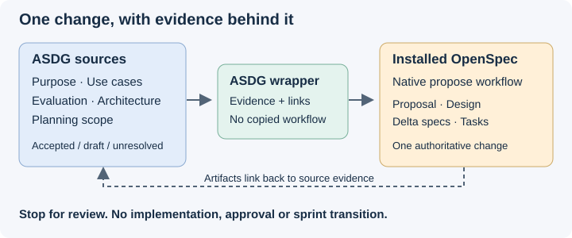

# Carry decisions into a proposal without duplicating them

ASDG explains the product and its development decisions. OpenSpec holds the proposed change and its implementation-facing delta. Links keep the two connected while each artifact has one authoritative location.

## Load the relevant baseline

From the client root, run `python3 asdg/scripts/cli.py status --json` and inspect Git status and revision. Read `.asdg/project.json`, `.asdg/lifecycle.json` and `.asdg/sprint.json`; do not modify them.
Use the [catalogue](../../00-governance/types/agent-catalog.json) and the binding's artifacts root to locate stages; do not reuse paths from another project or an old handoff.
Read each relevant stage's index, registered artifacts and linked decisions. Include user-named and relevant unregistered documents; an empty index does not mean an empty folder.

| ASDG source | Contribution to the proposed change |
| --- | --- |
| 02 Purpose | Desired benefit, constraints, non-goals and selected priorities. |
| 03 System Model and Use Cases | Actors, observable behavior, scenarios and unresolved interactions. |
| 04 Evaluation Strategy | Success criteria, benchmarks, measurement limits and untested thresholds. |
| 05 Architecture | Boundaries, accepted design decisions, current implementation evidence and alternatives. |
| 07 Planning plus authoritative sprint/release state | Selected work, exclusions, dependencies and whether this is current or possible future work. |

Inspect relevant application code/tests read-only as the native workflow requires. Source behavior is not proof of a successful runtime or user outcome.
Do not adopt a methodology backlog as the application's delivery plan or widen an active sprint to include a proposed next feature.
For absent inputs, name the missing evidence and its effect. Ask before writing if it materially changes the proposal; otherwise retain it as a visible limitation.

## Establish decision status, not just document presence

Record each source's relative path/link, SHA-256 of the bytes read, relevant claim and decision status in the proposal's source table, or another schema-supported section of that same change.
Use current CLI completion plus the exact review records and covered artifact hashes. A stage-level ACCEPTED label does not approve every file in that folder.
Separate accepted current bytes, stale acceptance of older bytes, draft/unreviewed material, explicit stakeholder direction and unresolved questions.
AI-MODIFIED receipts record authorship only. “Accepted” prose, Git commits, existing files and successful validation are not human approval.
If a review record cannot establish coverage of the current bytes, report acceptance as unverified; do not repair the ledger or carry acceptance forward.
Document substantive conflicts with both source links, the behavior affected and the decision needed. Do not silently prefer the newest document or the older accepted one.
For example, a new explicit-confirmation use case can conflict with an accepted automatic-promotion architecture. Preserve both claims until the human resolves the intended change.

## Keep one authoritative copy

Keep ASDG purpose, use cases, evaluation, architecture and cycle state at their existing locations.
Keep the OpenSpec proposal, design, delta specs and tasks only at the paths resolved by the native CLI, not mirrored under `docs/asdg/`.
Write a delta specific to the requested change; link existing decisions instead of pasting whole ASDG documents or creating a second task list.
In every resulting artifact, link its relevant ASDG sources or the proposal's source table and identify which claims/scenarios/tasks those links support. For nested specs, calculate relative links from that file's directory.
Use schema-compatible sections or short inline references without damaging requirement/scenario/task syntax. Do not copy raw OpenSpec context or rules into the artifacts.
For a separate planning store, use stable repository URLs pinned to the observed revision when available. For uncommitted/local-only sources, identify the checkout and exact hash, disclose portability limits and never invent a remote URL.
A Planning-owned Stage 07 navigation entry may point to the change and its pending review questions; it must not duplicate the plan or imply sprint selection.
Recheck linked bytes before finishing. Source drift requires an updated assessment, not an inherited approval.
