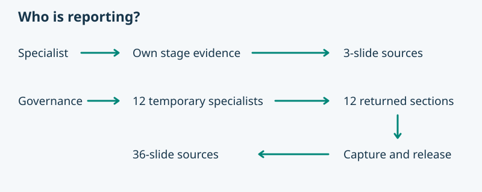

# ASDG Report Project Status

## Resolve the request

1. Load the client instructions, [session policy](../asdg-focus/session-policy.md), actual role contract and [role catalogue](../../00-governance/types/agent-catalog.json). Preserve the caller's role, subject and attitude. Recover a missing binding or role before dispatch. Admin is outside the reporting roster.
2. Capture one run ID, project binding, as-of time, revision and relevant working-tree state. Read the client CLI's `status --json` and current stage evidence where available. Missing evidence stays unknown. Project files, code, tests, deployments and dated human decisions support different claims.
3. Follow [write controls](../../00-governance/docs/write-controls.md). Put the run in a fresh report directory under the invoking role's verified, owned client artifact root. Resolve the actual root from the binding. Check every target and the build operation before use. Never bypass a refusal or expand a permission. A report requests no implementation, approval or sprint transition.

## Specialist mode

4. For an active lifecycle specialist, report only that stage. Author the three slide records in [the section contract](packets.md). Use an appropriate project example, evidence and narration. Dispatch no children.
5. When explicitly assigned a section by Governance, return the packet directly to its parent. Do not build a deck, contact peers or invoke this skill recursively. In a direct human invocation, validate its single-role envelope with the same packet checker, then deliver the editable three-slide sources and make the final export.

## Governance mode

6. From accountable `ASDG-COORDINATOR`, enumerate stages 01–12 from the live catalogue. The current Claude integration has no named ASDG role adapters: stop Governance reporting there with a delegation-unavailable receipt. Direct specialist reporting remains available. In Codex, verify actual named-role dispatch and completion/release tools before assigning work. An explicit invocation requests temporary project-report workers. Do not create or repurpose persistent team chats.
7. Dispatch one bounded, read-only assignment for each catalogue role. Use its registered native identity and task-local context. Give it the run ID, snapshot, role entry, stage sources, expected packet and return channel. Require it to load its own entry and stage procedure. Keep the parent in Governance. Use waves when concurrency is limited.
8. Collect each final response. Validate identity, project/snapshot, role load, three slide records and evidence. Persist the returned packet or its exact durable reference, plus observable dispatch/completion identifiers, before releasing the worker. Close it if supported, or record documented automatic completion. Report uncertain closure honestly. Preserve only business evidence and visible activity.
9. Handle a malformed return or transient timeout with one bounded retry when safe. Retain attempts. Record unavailable, failed or missing roles in the run manifest; never author their conclusions on their behalf. A missing role is a coverage gap. A responding role can legitimately report unknown project status.
10. Run the [read-only packet checker](report_packets.md) on the recorded outcomes before assembly. Use its slide order, retaining individual failures and rejecting invalid packets. The complete default deck is 36 slides; add a cover or summary only when specifically requested. For partial coverage, use the returned sections plus one brief coverage slide and mark the deck PARTIAL. If no role responded, return a blocked run receipt without presenting a project report.

## Author and deliver the presentation sources

11. Author the run’s primary deliverable under `<run>/presentation/`. Start with `README.md` containing a short Markdown status summary, scope, snapshot, coverage and an ordered, illustrated index. Embed each slide visual and link its speaker notes with relative paths. The index and its source links must work when `build/` does not exist.
12. For each slide, create a numbered descriptive folder containing an editable, self-contained `slide.svg` and `speaker-notes.md`. Write the spoken explanation in Markdown and end with `## Fine print` for evidence. Use the existing ASDG presentation standard for optional layered notes. Keep original shared artwork/screenshots in sibling `<run>/images/` when used. Link originals from the Markdown; embed required image data in the slide SVG. Keep worker receipts outside `presentation/`.
13. Read the source report in order. Check that each visual expresses the worker’s finding, every note and referenced local image opens, and all three parts of each returned section are present. Edit these sources for revisions. Record source readiness and coverage independently of export status.
14. Export last. Follow the [renderer preflight](report_packets.md#powerpoint-renderer); use the reviewed provider builder on the `presentation/` directory with `--narration intro --check`, then build. Verify the resulting PPTX, notes and preview inside `presentation/build/`. If the renderer is unavailable, deliver the checked source tree and mark only the export blocked.
15. Return the illustrated Markdown index and complete source folder first, the generated PPTX second, and the coverage/receipt. A download bundle must retain the relative folder tree, including used originals and numbered slide sources. Rendered outputs alone are an incomplete handoff.
