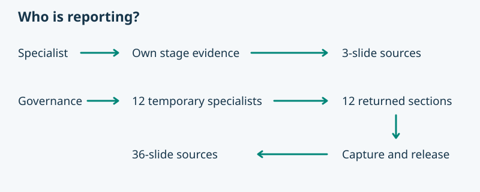

# Check report packets

The read-only helper compares the parent’s run envelope with the installed role catalogue, validates slide fields, and returns an ordered build plan on stdout. Run it with the installed Python runtime: `python3 -B asdg/skills/asdg-report-project-status/report_packets.py <run.json>`. Pass `--provider <reviewed-provider-root>` to locate the renderer. Inspect the returned `renderer.status` separately from coverage. LOCATED confirms file presence only. It creates no directories and executes no worker or renderer.

## Run envelope

Supply nonempty `run_id`, `project`, and `snapshot`. The snapshot identifies the shared as-of time, revision and relevant working-tree baseline. Set `client` to `codex` or `claude` and `owner` to the verified invoker’s role ID. The parent records `named_delegation: true` only after observing host support. The helper consults the installed catalogue to derive the expected roles.

`outcomes` is a JSON object keyed by expected role ID. Governance records all twelve. A direct specialist records only its own. Record one final outcome per role after any retries, retaining the individual attempts in the parent receipt. Use an object with a nonempty `reason` when a role could not return a valid packet. For a successful return supply `packet`. Governance also records a unique `worker_ref` pointing to its verified assignment/return receipt.

Each packet repeats `run_id`, `project`, `snapshot` and supplies `role_id`, `loaded` (including that role’s catalogue entry and stage skill paths) and `slides`. Each slide supplies `kind`, `headline`, one to three visible `points`, a `visual_brief` describing what the editable visual should explain, spoken Markdown `notes` and nonempty `sources`. Record checked locations even when the substantive evidence is absent. Link individual claims in notes. The three kinds in order are `definition`, `status`, `plan`.

## Interpret the result

- Exit 0: `COMPLETE` or `PARTIAL`. Author the returned slides in order. Partial coverage ends with one coverage slide listing absent roles and reasons.
- Exit 1: explicit all-missing outcomes produce a `BLOCKED` receipt with zero slides.
- Exit 2: malformed input or unsupported delegation. Resolve the error first. A rejected return can be recorded as an explicit missing outcome after the bounded retry. A host-wide delegation block ends the Governance run.
- A structurally valid packet proves neither factual accuracy nor actual worker activation. Inspect the evidence and native receipt before accepting it.

## PowerPoint renderer

A fresh client has the reporting workflow and packet checker. Its ZIP intentionally omits the provider presentation builder. Resolve a reviewed provider checkout explicitly and record its path, revision and applicable local changes. Never search for or execute an arbitrary global renderer.

Use that provider’s `asdg/skills/asdg-presentation/src/build.py`, its `requirements.txt` and a working system Cairo library. Open its presentation standard and building guide locally. If any prerequisite is unavailable, report which one and deliver the checked Markdown index, numbered slide sources, and shared original images.

With the reviewed renderer interpreter and an absolute path to the authorized client presentation source directory, run the builder with `--presentation <report-dir> --narration intro --check`, then repeat without `--check`. Verify the resulting PPTX, speaker notes and manifest inside `presentation/build/`. A successful fixture render does not verify a live agent runtime.
