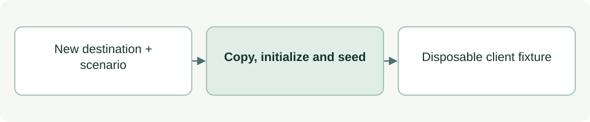

# Disposable continuation scenarios

[Source: continuation_fixture.py](continuation_fixture.py)

Builds isolated client repositories for trying ASDG continuation behavior against empty, partial, accepted or stale Purpose evidence.

## Responsibilities and collaborators

Creates a new temporary-style project, copies the embedded package, initializes Git/ASDG and seeds explicitly simulated review records.

- [cli_project](../scripts/lib/cli_project.md): Plans disposable integration; the fixture explicitly applies those changes through cli_files.
- [purpose_review](../scripts/lib/purpose_review.md): Provides canonical Purpose filenames, criteria and bundle hashes.

## Interface and data

scenario is 'empty' | 'partial' | 'accepted' | 'stale'; root is a Path that must not exist. Returned Path is the resolved fixture root.

| Callable or interface | Contract |
| --- | --- |
| `create_fixture(root: Path, scenario: str) -> Path` | Creates the requested scenario, writes FIXTURE.txt and returns its root. accepted/stale cases seed synthetic readiness and acceptance; stale then edits the reviewed purpose. |

## Effects and failure behavior

Rejects unknown scenarios and existing destinations; Git/copy/write errors can propagate and leave a partial fixture. These records are role-play, not actual human approval. It launches git init and writes only the chosen new fixture tree.

## Example

`python3 asdg/tests/continuation_fixture.py /tmp/asdg-example partial` creates a new disposable partial-Purpose client.
