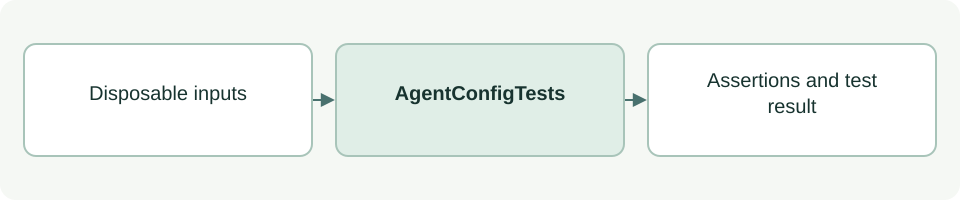

# Agent configuration compatibility tests

[Source: test_agent_config.py](test_agent_config.py)

Checks that packaged role adapters parse consistently through the portable fallback, while unsupported syntax and duplicate keys fail.

## Responsibilities and collaborators

Owns deterministic regression fixtures and assertions for the behavior described below.

- [agent_config](../scripts/lib/agent_config.md): Native/fallback parsing under test.

## Interface and data

AgentConfigTests extends unittest.TestCase. Test methods use per-test state; simulated decisions never modify real project acceptance.

The [test case guide](test_agent_config-cases.md) lists every `test_*` method and the behavior it checks.

## Effects and failure behavior

All test_* methods take self and return None; unittest reports assertion failures. The suite reads packaged TOML adapters and performs in-memory parser checks.

## Example

From the project root: `TMPDIR=/private/tmp python3 -B -m unittest discover -s asdg/tests -p 'test_agent_config.py'`.
